# FiCol database architecture

Version 2.5 | Business-process baseline dated 13 October 2026 | Reconciled with code and local database 19 October 2026 | Django web application | Production-oriented architectural proposal

**Status:** Updated design reference for review and staged implementation. This file does not authorize application edits, migrations, database writes, or live deployment. All sample records are fictional. Production readiness requires approved policies, implementation, concurrency tests and deployment verification.

**Revision:** Version 2.5 reconciles the current implementation with the codebase and local PostgreSQL database `ficol_db` as of 19 October 2026. Twenty-nine (29) domain model definitions exist, including `CustomerContact` and `AccountInformationProposal` (implemented under `apps/accounts/information/`), `Document`, `Payment`, `AssignmentReleaseRequest`, `InformationEarningRule`, `Commission`, `Payout`, `PayoutItem`, `PointRule`, and `PointTransaction`. The original 29-model target (the original 28-model proposal plus `AssignmentReleaseRequest`) has 27 implemented; only two (2) models from that target remain unimplemented (`CollectorServiceArea` and `IntegrationEvent`). With the addition of `AccountInformationProposal` and `InformationEarningRule`, the total domain universe is 29 implemented + 2 unimplemented = 31 models. Migration `collection: 0005` is owner-reported applied in `ficol_db` and not independently rechecked in this session. Migration `collection: 0006_verified_points.py` is generated in code but unapplied to the local database. This documentation update performs no application changes, migrations or database writes.

**Precedence:** Section 20 is authoritative for the 18 October 2026 current implementation status and supersedes earlier historical summaries. Sections 0, 18 and 19 describe historical development milestones, design decisions and prior reviews. Section 17 and dated implementation records are historical evidence, not current completion claims. Section 4 remains a design reference with illustrative fields/samples; exact implemented field definitions and constraints are in the current models/migrations. Do not implement new fields merely because a proposed schema lists them. Manual Back Office assignment/reassignment, the `event_id` field and `manage_account_assignments` permission on `AccountAssignment`, and the `superseded` release lifecycle on `AssignmentReleaseRequest` are implemented in code with migration `assignments: 0005` applied in `ficol_db`. Information proposals and Back Office validation are implemented under `apps/accounts/information/` with migration `accounts: 0006` applied in `ficol_db` (branch status: unmerged into `origin/main` based on locally recorded refs). Direct login portal routing is implemented (`/login/success/` removed), and the collector dashboard queries live assigned accounts with working links.

## 0. Answered process rules and precedence

The answered questionnaire supplies operational rules missing from the original product vision. It supersedes conflicting development assumptions, including ordinary visits requiring no review, collector-controlled follow-up dates, and assuming commission is a percentage of customer payments. This is a revised target design, not a claim that the current application already enforces it. WIRED integration remains deferred by the owner.

| Process | Answer supplied | Revised design | Remaining qualification |
|---|---|---|---|
| Collector approval | Manually encoded and approved by admin through CRM | CRM-admin approval is the production authority; local development approval must not impersonate CRM confirmation | CRM integration/import mechanism remains deferred |
| Work allocation | Maximum 10 accounts within 24 hours; one account at a time | Owner approved multiple assigned accounts with only one being worked on at a time; current visit workflow enforces one ongoing visit per collector | Owner approved up to ten new offer acceptances in a rolling 24 hours; implementation complete, database-backed verification pending |
| First action | ASAP | Encourage prompt action; do not invent an exact ASAP deadline | Offer acceptance timeout still unanswered |
| Activity types | Calls, email, SMS, field visit, promise to pay, proof-of-payment upload | Add authenticated recording of remote activities alongside physical visits; logs do not automatically send messages | Confirm which activities qualify for inactivity reset |
| Inactivity | No activity after 24 hours causes release/reassignment | Audited, race-safe inactivity/reassignment workflow over qualifying activity | Confirm when clock starts/resets, whether pending reports count, and permitted grace |
| Collector-requested release | Yes, subject to admin approval | A pending release request leaves ownership active until an authorized decision | Admin reviewer/override permission mapping |
| Visit evidence | Proof of transaction | Back Office Admin reviews supporting evidence | Meaning for unsuccessful/non-payment visits is unclear |
| GPS/address issue | Collector marks wrong address | Keep device-location failure distinct from a reported address problem; submit a claim for review | Clarify whether the answer intended these to be the same operation; no automatic corruption of verified addresses |
| Visit report review | Back Office Admin; rejected report receives no payment | Restore submitted report review; rejected evidence cannot produce collector remuneration | Whether approval is required before another visit remains unanswered; do not introduce that gate |
| Customer payment | Collector cannot receive it; may assist customer and upload proof | Report customer's payment evidence only; no collector cash-receipt/custody workflow or payment gateway | Allowed customer payment channels and evidence formats |
| Collector remuneration | Company pays; computed per client and valid information acquired | Versioned client rates for validated information; payment-percentage commission is not the confirmed default | Actual rates, eligible information categories, calculation frequency and payout timing |
| Follow-ups | Admin sets deadlines; missed follow-up routed to another collector | Admin-authorized schedule/deadline; collectors may propose dates without making them effective | Distinguish revisit availability from completion deadline, grace and transfer timing |
| Closure | Full balance paid; admin approves | Verified financial evidence plus authorized closure decision | Source reconciliation process while integration is deferred |
| Points | Valid address, email, phone, contact person, payment arrangement: one point each, admin validated | Five explicit verified categories, one point per eligible unique validation | Deduplication scope, repeated arrangements, caps and reversal policy |

**Independent decisions:** Visit evidence review, payment verification, information validation, collector commission approval/payout and account closure are separate. Rejecting a visit must not silently reject/reverse a genuine customer payment. The statement about no payment after rejection is treated as collector remuneration, pending confirmation; it is not authority to delete financial evidence.

**Unresolved details are not filled with production defaults.** In particular, capacity=10 does not implement ten accounts per day; a completed visit is not proof that new information is valid; one reward point is not one peso; GPS failure is not proof of a wrong address; and one due timestamp must not make a revisit simultaneously available and already missed.

## 1. System overview and agreed scope

FiCol receives collection cases from WIRED CRM, finds eligible collectors using their **current GPS location**, offers work, protects exclusive account ownership, records visits and evidence, reports payments for verification, and tracks commissions and verified points. It is a responsive Django website intended for actual company operations, not just a presentation demo.

The collector portal provides the dashboard, offers, assigned accounts, account details, visits, follow-ups, payment reporting, earnings, performance, and profile. The management portal handles approval, assignment overrides, evidence/payment review, configuration, finance, reporting, and audits. Client managers receive only explicitly authorized client scope. A customer/debtor login portal is not established by the requirements.

### Agreed architectural decisions

| Topic | Decision |
|---|---|
| Delivery | Django web application with mobile-friendly layouts; no native mobile app assumed |
| Matching | Current GPS, availability, approval, capacity, and agreed eligibility rules |
| Ownership | One exclusive active assignment until authorized completion, release, expiry, or reassignment |
| New collectors | A closer or newly registered collector does not replace an active owner |
| Payments | Customer pays an authorized recipient; FC may assist and upload proof but cannot receive money. Reporting and verification remain separate |
| Commissions | Company-funded remuneration per client and validated information; actual rates pending. Existing percentage/fixed/tiered code is implemented capability, not confirmed production policy |
| Configuration | A small set of typed, validated settings and versioned financial/reward rules; no generic rule builder |
| History | Preserve accepted terms, deadlines, verification evidence and settled amounts when settings change |
| Testing | Fictional nearby accounts use the same schema in a separate development database |
| File/database control | This deliverable changes no application files, migrations or database records |

The original Word document is a product vision. The answered questionnaire confirms admin review, the 24-hour inactivity policy, company-funded information-based remuneration and five one-point categories; exact rates and several deadline/capacity semantics remain unanswered. Proposed technical defaults can guide development; operational values and approval authority need business sign-off before live use. Territory restrictions may supplement GPS if approved; registered city alone never replaces missing GPS.

### Existing code and implementation progress, reviewed 18 October 2026

| Area | Current code | Remaining work / verification |
|---|---|---|
| Foundation | Users/profiles/client grants, clients/customers/addresses/accounts, PostGIS locations and territories. Direct login portal routing implemented (`/login/success/` removed); collector dashboard displays live assigned accounts with working links | Legacy capacity_limit is stored but unused; no active-account cap is enforced |
| Ownership and maps | Offers, exclusive ownership, availability, GPS validation, map offers, My Accounts, rolling ten-acceptance limit | Owner exercised offer acceptance; full PostgreSQL constraint/concurrency suites remain unrun |
| Field work | Visits, promises, history and one ongoing visit per collector; submitted reports enter Back Office review | Owner reported Start Visit/Submit Visit working; strict arrival/evidence policy and remote activity UI remain incomplete |
| Follow-ups | Collector requests; staff authorizes earliest-start/deadline windows or rejects; late ongoing visit completion preserved | Automated missed-task transfer and grace policy remain pending |
| Release | AssignmentReleaseRequest, scoped staff approve/reject, task cancellation, former-owner evidence-access restriction; `superseded` status implemented | Migration `assignments: 0005` applied in `ficol_db`; independent file-access/task/concurrency checks remain pending |
| Payment/evidence | Payment and Document models, private uploads, reporting and independent verification | Migrations applied (`activities: 0005, 0006`, `collection: 0004` in `ficol_db`); no funds processed, balances changed, commissions awarded or accounts closed by verification; full browser/DB verification incomplete |
| Back Office assignment | Manual assignment/reassignment implemented: `event_id`, permission `manage_account_assignments`, exact idempotency, bounded retries, lock ordering, superseded release requests and audit logging | Database migration `assignments: 0005` applied in `ficol_db`; live constraint and concurrency tests remain pending |
| Information validation | `CustomerContact` and `AccountInformationProposal` implemented under `apps/accounts/information/`; Back Office validation queue implemented (`accounts.validate_account_information` permission) | Database migration `accounts: 0006` applied in `ficol_db`; branch `feature/pito-information-validation` remains unmerged into `origin/main` based on locally recorded refs |
| Rewards/earnings | Versioned earning-rule foundations and frozen assignment terms | Validated-information rates, points, commissions and payouts are not completed workflows |
| Frontend | Shared responsive layout, local compiled Tailwind, favicon, separate page/component scripts | Desktop/mobile visual regression checks remain required |
| Integration/deployment | Source namespace controls; TEST enabled by default | WIRED, automatic reassignment, offline synchronization and production deployment remain incomplete |

Twenty-nine (29) domain models are defined in code: `Client`, `Customer`, `CustomerAddress`, `CustomerContact`, `Account`, `AccountInformationProposal`, `FieldActivity`, `FollowUpTask`, `Document`, `CollectorLocation`, `Territory`, `AccountOffer`, `AccountAssignment`, `AssignmentReleaseRequest`, `AuditEvent`, `CommissionRule`, `CommissionTier`, `PromiseToPay`, `Payment`, `Notification`, `User`, `CollectorProfile`, `ClientAccess`, `InformationEarningRule`, `Commission`, `Payout`, `PayoutItem`, `PointRule`, and `PointTransaction`. This excludes Django framework models (`admin.LogEntry`, `auth.Permission`, `auth.Group`, `contenttypes.ContentType`, `sessions.Session`, `gis.PostGISGeometryColumns`, `gis.PostGISSpatialRefSys`) and framework intermediary M2M tables (`auth_group_permissions`, `user_user_groups`, `user_user_user_permissions`). Only two models from the original 29-model provisional proposal remain unimplemented: `CollectorServiceArea` and `IntegrationEvent`. Adding `AccountInformationProposal` and `InformationEarningRule` yields a total domain universe of 31 models (29 implemented + 2 unimplemented). Migration `collection: 0005` is owner-reported applied in `ficol_db` and not independently rechecked in this session. Migration `collection: 0006_verified_points.py` is generated in code but unapplied to the local development database. Internal IDs remain technical keys, not visible identity numbers.

## 2. Design summary and implementation stages

The original **28-domain-model foundation** was expanded to 29 when `AssignmentReleaseRequest` was added. In the current codebase, 29 domain models exist (including `CustomerContact`, `AccountInformationProposal`, `InformationEarningRule`, `Commission`, `Payout`, `PayoutItem`, `PointRule`, and `PointTransaction`), while only two models from the original proposal remain unimplemented (`CollectorServiceArea` and `IntegrationEvent`). Adding `AccountInformationProposal` and `InformationEarningRule` yields a total domain universe of 31 models (29 implemented + 2 unimplemented). Table existence and applied migration state are verified in `ficol_db` (migration `collection: 0005` is owner-reported applied and not independently rechecked in this session; migration `collection: 0006` is generated in code but unapplied to the database); migrated constraints, relationships and complete workflows remain separate verification questions. Territory and CollectorServiceArea are conditional modules, not prerequisites for the first GPS test. Django framework auth/session/migration tables remain outside this domain count.

Use PostgreSQL for operational transactions and constraints. The spatial target is PostgreSQL **with PostGIS** and GeoDjango geography points. PostGIS is enabled in ficol_db according to the owner's SQL output, the Django PostGIS backend is configured, and local GDAL/GEOS loading has passed. The owner also supplied a successful PostGIS query through Django and reported applying CollectorLocation's migration. Actual spatial table/index/constraint state and model persistence have not been independently verified; preserve that distinction before further spatial migrations.

| Stage | Models / behavior | Acceptance criterion |
|---|---|---|
| Existing foundation | User, CollectorProfile, Client, ClientAccess | Preserve current authentication and data |
| A: Collector readiness | AuditEvent, protected availability changes, CollectorLocation, typed GPS settings | Approved collectors change own availability and submit validated fixes |
| B: Nearby-account testing | Customer, CustomerAddress, Account, optional CustomerContact; CommissionRule/Tier before actionable offers | Fictional nearby/far cases produce expected eligibility |
| C: Ownership | AccountOffer, AccountAssignment, Notification | Competing acceptances produce one owner; capacity remains correct |
| D: Field work | FieldActivity, Document, FollowUpTask, CustomerContact, PromiseToPay | Authorized, reviewable evidence and scheduled work |
| E: Financial/performance review | Payment, Commission, Payout, PayoutItem, PointRule, PointTransaction | Independent review, immutable calculations and deduplicated rewards |
| F: Source synchronization — deferred | IntegrationEvent and approved WIRED adapters | Owner must separately authorize resuming integration |
| Conditional territories | Territory, CollectorServiceArea | Only if agreed as an additional GPS eligibility restriction |

These stages are dependencies, not a promise of a complete production system in two weeks. Enable only workflows with their required supervisor review paths. No new generic settings, customer-authentication, matching-engine, stars-balance or dynamic-formula table is proposed. Sections 13-15 cover configuration, invariants and release readiness.

### 2.1 Windows development and spatial prerequisites

Use one consistent spatial target: PostgreSQL with PostGIS. Runtime database inspection on `ficol_db` confirms **PostgreSQL 18.6** (`PostgreSQL 18.6, compiled by Visual C++ build 1944, 64-bit`) and **PostGIS 3.6.2** (`POSTGIS="3.6.2" [EXTENSION] PGSQL="180" GEOS="3.14.0-CAPI-1.20.0" PROJ="8.2.1"`). The GeoDjango spatial backend is configured and local GDAL/GEOS loading is functional. Before approving new PointField migrations, verify compatible GDAL/GEOS/PROJ libraries and runtime discovery paths across development and test environments. A containerized application/runtime or a correctly provisioned Windows environment are explicit setup options, not automatic fallbacks.

A Haversine function may support isolated calculation tests, but it cannot make GeoDjango PointFields compatible with ordinary SQLite or remove native dependencies. Ownership, migrations, exclusion constraints and spatial integration tests must run against the intended PostgreSQL/PostGIS stack. Any alternative Decimal coordinate schema remains a separate design decision requiring approval; do not silently add duplicate coordinates or switch storage engines.

### Conventions and common fields

Every domain table has the following physical fields. User inherits Django authentication timestamps separately; CollectorLocation has received_at in addition to these. Append-only tables omit updated_at.

| Field | Django type | Constraints | Purpose | Example |
|---|---|---|---|---|
| id | BigAutoField | Primary key; required; generated | Internal stable identifier | 100 |
| created_at | DateTimeField | Required; auto_now_add; except User uses date_joined | Server creation time; for audit/ledger this is event insertion time | 2026-10-08T01:00Z |
| updated_at | DateTimeField | Required; auto_now; absent on append-only tables and User | Last server modification time | 2026-10-08T02:00Z |

All dates/times use aware UTC storage and Asia/Manila display. Calendar promises use DateField. DecimalField stores exact money/rates; FloatField is not used for currency. BigAutoField is sufficient for relational PKs; separate UUID event IDs make retryable submissions safe. CharField limits bounded labels/identifiers; TextField stores variable notes; JSON is limited to redacted audit evidence, schema-validated historical policy snapshots and minimal integration payloads, never core relationships or editable formulas. PointField stores WGS84 longitude/latitude. Positive integer types still need explicit >0 checks when zero is not valid.

Required means NOT NULL plus form/service validation; string fields must be nonblank where required. Optional strings use blank=True and empty string unless optional uniqueness explicitly uses NULL. Optional FKs/numbers/timestamps use null=True and blank=True. Choices require explicit validation; choices alone do not enforce all database writes. Default values shown are proposals, not source-approved rates or deadlines. Each FK automatically receives a database index unless a reviewed reason dictates otherwise. Every noncommon field follows below; PK/common fields apply to every section.

## 3. List of models and their purposes

The table below lists all 30 domain models in the current architecture: 23 are implemented in code with migrations applied in `ficol_db`, and 7 remain proposed/unimplemented from the original provisional design.

| Django model | App | Physical database table | Purpose / Status |
|---|---|---|---|
| User | user | user_user | Authentication and identity for collectors, supervisors, administrators, and client managers. Custom user based on AbstractUser. Implemented; migration `user: 0001` applied. |
| CollectorProfile | user | user_collectorprofile | Collector approval, working availability, capacity, and proximity preferences. Implemented; migration `user: 0001` applied. |
| CollectorLocation | assignments | assignments_collectorlocation | Latest GPS fix used for live nearby matching. Implemented; migration `assignments: 0001` applied. |
| Territory | assignments | assignments_territory | Configured geographical eligibility areas. Implemented; migration `assignments: 0001` applied. |
| CollectorServiceArea (proposed) | assignments | assignments_collectorservicearea | **Proposed / Unimplemented.** Explicit M:N link between collectors and eligible territories. |
| Client | accounts | accounts_client | The creditor or agency supplying accounts. Implemented; migration `accounts: 0001` applied. |
| ClientAccess | user | user_clientaccess | Restricts client managers to explicitly authorized clients. Implemented; migration `user: 0001` applied. |
| Customer | accounts | accounts_customer | A debtor person or business, scoped to its source client. Implemented; migration `accounts: 0002` applied. |
| CustomerContact (implemented) | accounts | accounts_customercontact | Individual contact points and verification state. Implemented in `apps/accounts/information/`; migration `accounts: 0006` applied. |
| CustomerAddress | accounts | accounts_customeraddress | Residential, business, or newly discovered address, with coordinates. Implemented; migration `accounts: 0003` applied. |
| Account | accounts | accounts_account | The collection case. Stores client account identity and CRM balance snapshot. Implemented; migration `accounts: 0003` applied. |
| AccountInformationProposal (implemented) | accounts | accounts_accountinformationproposal | Collector-proposed contact, address or notes updates awaiting Back Office validation. Implemented in `apps/accounts/information/`; migration `accounts: 0006` applied (feature branch unmerged to `origin/main` based on local refs). |
| AccountOffer | assignments | assignments_accountoffer | Time-limited invitation with location and commission terms. Implemented; migration `assignments: 0001` applied. |
| AccountAssignment (implemented) | assignments | assignments_accountassignment | Exclusive active ownership and historical episodes. Includes `event_id` and `manage_account_assignments` permission for manual assignment. Implemented; migration `assignments: 0005` applied. |
| AssignmentReleaseRequest (implemented) | assignments | assignments_assignmentreleaserequest | Admin approval of collector release requests; includes `superseded` lifecycle status. Implemented; migration `assignments: 0005` applied. |
| FieldActivity | activities | activities_fieldactivity | Visit/contact attempts and review evidence. Implemented; migration `activities: 0007` applied (one ongoing visit per collector). |
| Document | activities | activities_document | Metadata for photos, receipts, demand letters, and evidence. Implemented; migration `activities: 0005` applied. |
| FollowUpTask | activities | activities_followuptask | Scheduled actions and revisit authorization. Implemented; migration `activities: 0004` applied. |
| PromiseToPay | collection | collection_promisetopay | Customer commitment to amount and date. Implemented; migration `collection: 0003` applied. |
| Payment | collection | collection_payment | Reported customer payment evidence and verification. Implemented; migration `collection: 0004` applied. |
| CommissionRule | collection | collection_commissionrule | Versioned earning terms (percentage, fixed, tiered). Implemented; migration `collection: 0001` applied. |
| CommissionTier | collection | collection_commissiontier | Ordered amount bands owned by tiered rules. Implemented; migration `collection: 0002` applied. |
| Commission (proposed) | collection | collection_commission | **Proposed / Unimplemented.** Versioned earning result, distinct from payment and payout. |
| Payout (proposed) | collection | collection_payout | **Proposed / Unimplemented.** Documented payment of approved earnings to a collector. |
| PayoutItem (proposed) | collection | collection_payoutitem | **Proposed / Unimplemented.** Allocation of approved commissions into payout batches. |
| PointRule (proposed) | core | core_pointrule | **Proposed / Unimplemented.** Versioned verified-activity reward rules. |
| PointTransaction (proposed) | core | core_pointtransaction | **Proposed / Unimplemented.** Append-only ledger of earned/reversed points. |
| Notification | core | core_notification | User-facing offer, deadline, review, and earning messages. Implemented; migration `core: 0001` applied. |
| AuditEvent | audit | audit_auditevent | Append-only security and business change evidence. Implemented; migration `audit: 0001` applied. |
| IntegrationEvent (proposed) | integrations | integrations_integrationevent | **Proposed / Unimplemented.** Per-record CRM/CSV synchronization tracking. WIRED integration deferred. |

The physical names use Django's default app_label_modelname convention; no custom db_table is required. Singular user and collection are your existing app labels. Framework authentication tables are described separately below; no redundant authentication implementation is proposed. Exactly 43 migrations are applied across all apps in `ficol_db` (25 application, 18 framework; 0 pending).

## 4. Detailed fields, purposes, sample records, and usage

Each table inherits the documented common fields. Sample rows show meaningful columns rather than repeating default IDs/timestamps; all identities, addresses, references, rates, and contacts are synthetic. Samples illustrate valid states at different workflow times, not one complete seed dataset.

### 4.1 User

**Architecture status:** Existing model definition and initial migration in code; live migration state unverified. Separately marked proposed fields are not implemented.

**Table:** `user_user`. **Purpose:** Authentication and identity for collectors, supervisors, administrators, and client managers. Existing custom user based on AbstractUser; every user relationship references the configured AUTH_USER_MODEL.

| Field name | Data type | Constraints | Purpose | Example value |
|---|---|---|---|---|
| username | CharField(150) | Required; unique; Django username validator | Login identifier | maria.fc |
| password | CharField(128) | Required; Django password hashing only | Encoded password, never plaintext | encoded hash |
| first_name | CharField(150) | Optional; default empty string | Given name | Maria |
| last_name | CharField(150) | Optional; default empty string | Family name | Santos |
| email | EmailField(254) | Optional; default empty string; not a login key initially | Contact email with email validation | maria@example.test |
| is_active | BooleanField | Default True | Allows deactivation without deleting history | True |
| is_staff | BooleanField | Default False | Controls access to Django Admin; not a business role | False |
| is_superuser | BooleanField | Default False; tightly restricted | Django permission bypass for system administration | False |
| last_login | DateTimeField | Optional; NULL | Last successful login time | 2026-10-08T01:00Z |
| date_joined | DateTimeField | Required; default server time | User registration time | 2026-10-08T00:00Z |
| groups | ManyToManyField(Group) | Optional; framework-owned join table | Collector/Supervisor/Admin/Client Manager permission groups | Collector |
| user_permissions | ManyToManyField(Permission) | Optional; framework-owned join table | Exceptional per-user permissions | review_payment |

**Integrity and validation:** Do not also create a separate password table or duplicate role field. Use groups for multiple roles. AUTH_USER_MODEL is already user.User. Preserve it; do not reset authentication tables or migration history.

**Example records:**

- id=1, username=maria.fc, first_name=Maria, group=Collector
- id=2, username=leo.fc, first_name=Leo, group=Collector
- id=3, username=supervisor.rosa, first_name=Rosa, group=Supervisor

**Create / retrieve / update / delete:** Create at onboarding; retrieve at login; update contact details and permissions; deactivate departed users rather than deleting them.

### 4.2 CollectorProfile

**Architecture status:** Existing model definition and initial migration in code; live migration state unverified. Separately marked proposed fields are not implemented.

**Table:** `user_collectorprofile`. **Purpose:** Collector approval, working availability, capacity, and proximity preferences separate from authentication.

| Field name | Data type | Constraints | Purpose | Example value |
|---|---|---|---|---|
| user | OneToOneField(User) | Required; PROTECT; unique | Owner of collector profile | 1 |
| approval_status | CharField(20) | Default pending; pending/approved/rejected/suspended | Determines eligibility for offers | approved |
| availability | CharField(20) | Default offline; online/busy/offline | Collector voluntarily available for new work | online |
| capacity_limit | PositiveSmallIntegerField | Legacy default 5; existing positive-value check retained | Compatibility field; not used to gate matching/acceptance | 5 (legacy, not enforced) |
| matching_radius_m | PositiveIntegerField | Default 5000; greater than zero; proposed configurable default | Limits straight-line GPS matching distance | 5000 |
| approved_by | ForeignKey(User) | Optional; PROTECT | Supervisor responsible for approval | 3 |
| approved_at | DateTimeField | Optional; NULL | Approval evidence timestamp | 2026-10-08T00:30Z |

**Integrity and validation:** A user has zero or one profile; every profile has exactly one user. Approved status requires reviewer and timestamp. Capacity is checked transactionally against active assignments, not stored as a mutable workload counter.

**Example records:**

- id=10, user=1, approval_status=approved, availability=online, capacity_limit=5
- id=11, user=2, approval_status=approved, availability=online, capacity_limit=3

**Create / retrieve / update / delete:** Create when a user registers as a collector; retrieve for eligibility; update approval and availability; suspend rather than delete.

### 4.3 CollectorLocation

**Architecture status:** Implemented model definition; Django generated assignments/0001_initial.py. Owner reported applying the migration. Actual database table and constraints remain independently unverified.

**Table:** `assignments_collectorlocation`. **Purpose:** Latest GPS fix used for live nearby matching. A separate row keeps frequently updated location out of the profile and avoids collecting continuous movement history.

| Field name | Data type | Constraints | Purpose | Example value |
|---|---|---|---|---|
| collector | OneToOneField(CollectorProfile) | Required; CASCADE; unique | Collector whose latest position this is | 10 |
| position | PointField(geography=True, srid=4326) | Required; spatial index | Longitude/latitude suitable for distance matching | POINT(120.9842 14.5995) |
| accuracy_m | DecimalField(8,2) | Required; check greater than or equal to zero | Reported GPS uncertainty in metres | 18.00 |
| captured_at | DateTimeField | Required | Device time of location observation | 2026-10-08T01:00Z |
| received_at | DateTimeField | Required; server time on each accepted update | Server freshness and clock-skew checks | 2026-10-08T01:00:03Z |

**Integrity and validation:** Live GPS is confirmed by the user. Reject missing/stale/inaccurate fixes for proximity offers; do not silently substitute territory matching. Browser permission and foreground updates are required; continuous background tracking is not assumed. Position uses X=longitude, Y=latitude.

**Example records:**

- id=1, collector=10, position=POINT(120.9842 14.5995), accuracy_m=18, captured_at=2026-10-08T01:00Z
- id=2, collector=11, position=POINT(121.0437 14.6760), accuracy_m=25, captured_at=2026-10-08T01:02Z

**Create / retrieve / update / delete:** Create on first consented location update; retrieve when matching; replace with a newer valid fix; clear according to the location retention policy.

### 4.4 Territory

**Architecture status:** Implemented model definition in `apps/assignments/models.py`; migration `assignments: 0002_territory.py` applied in `ficol_db`; physical table exists. Operational territory eligibility restrictions remain unactivated pending business requirement approval.

**Table:** `assignments_territory`. **Purpose:** Configured geographical eligibility areas; current GPS determines proximity; territories are additional optional restrictions only if approved.

| Field name | Data type | Constraints | Purpose | Example value |
|---|---|---|---|---|
| code | CharField(40) | Required; unique | Stable territory identifier | MNL-ERMITA |
| name | CharField(150) | Required | Human-readable service area | Ermita |
| city | CharField(100) | Required | City used in filters and operations | Manila |
| barangay | CharField(100) | Optional; default empty string | More precise area label | Barangay 670 |
| is_active | BooleanField | Default True | Whether area can receive new work | True |

**Integrity and validation:** City and barangay names are display fields; stable code identifies a configured territory. Polygon boundaries are deferred until required.

**Example records:**

- id=1, code=MNL-ERMITA, name=Ermita, city=Manila
- id=2, code=QC-CENTRAL, name=Central, city=Quezon City

**Create / retrieve / update / delete:** Create by administrator; retrieve for matching and filters; update display names; deactivate areas already referenced by accounts.

### 4.5 CollectorServiceArea

**Architecture status:** Proposed conditional module; **not implemented in codebase** (no model definition, migration, or table exists). Not required for the first GPS-based account test.

**Table:** `assignments_collectorservicearea`. **Purpose:** Explicit many-to-many link between collectors and eligible territories, with operational attributes.

| Field name | Data type | Constraints | Purpose | Example value |
|---|---|---|---|---|
| collector | ForeignKey(CollectorProfile) | Required; PROTECT | Collector allowed in this territory | 10 |
| territory | ForeignKey(Territory) | Required; PROTECT | Eligible territory | 1 |
| is_active | BooleanField | Default True | Enable or disable this service link | True |

**Integrity and validation:** Unique(collector, territory). A ManyToManyField through this model can expose the relationship without another join table.

**Example records:**

- id=1, collector=10, territory=1, is_active=True
- id=2, collector=11, territory=2, is_active=True

**Create / retrieve / update / delete:** Create when service area is approved; retrieve during matching; deactivate on territory change; unused mistaken links may be deleted with audit.

### 4.6 Client

**Architecture status:** Implemented model definition in `apps/accounts/models.py`; migrations `accounts: 0001` and `accounts: 0005` applied in `ficol_db`. Physical table and all 17 concrete fields exist. Operational policy values and runtime constraint enforcement on test DB remain pending.

**Table:** `accounts_client`. **Purpose:** The creditor or agency supplying accounts, distinct from the customer who owes money.

| Field name | Data type | Constraints | Purpose | Example value |
|---|---|---|---|---|
| code | CharField(40) | Required; unique | Stable client identifier | DEMO-LENDING |
| name | CharField(200) | Required | Creditor/agency name | Demo Lending Corporation |
| is_active | BooleanField | Default True | Allows new accounts and offers | True |
| offer_timeout_minutes | PositiveSmallIntegerField | Default 10; check > 0; provisional | Client offer response deadline | 10 |
| first_action_hours | PositiveSmallIntegerField | Default 24; check > 0; provisional | Deadline policy copied to assignments | 24 |
| policy_version | PositiveIntegerField | Default 1; check > 0 | Version saved in matching/deadline snapshots | 1 |
| gps_max_age_seconds | PositiveIntegerField | Default 300; check > 0 | Maximum age of captured observation | 300 |
| gps_max_accuracy_m | DecimalField(8,2) | Default 50.00; check > 0 | Maximum reported location uncertainty | 50.00 |
| gps_max_clock_skew_seconds | PositiveIntegerField | Default 120; check > 0 | Allowed device/server timestamp skew | 120 |
| matching_strategy | CharField(20) | Default nearest; choices: nearest/fan_out/manual | Known dispatch strategy | nearest |
| max_offer_recipients | PositiveSmallIntegerField | Default 1; check 1..20 | Simultaneous invite recipients; nearest uses 1 | 1 |
| require_service_area_membership | BooleanField | Default False | Additional territory eligibility alongside GPS | False |
| allow_collector_release | BooleanField | Default False | Allows collector-initiated release workflow | False |
| auto_reassignment_enabled | BooleanField | Default False | Enables assignment-expiry worker | False |

**Integrity and validation:** Rules are illustrative defaults, not rules supplied by the document. Model check constraints enforce positive GPS parameters, valid matching strategy, offer recipient limits (1..20), and positive timeouts. Operational policy values (such as timeouts, radius limits, and auto-reassignment flags) remain provisional pending business confirmation.

**Example records:**

- id=1, code=DEMO-LENDING, name=Demo Lending Corporation, policy_version=1
- id=2, code=DEMO-AGENCY, name=Demo Recovery Agency, policy_version=1

**Create / retrieve / update / delete:** Create before account import; retrieve for client filters and policies; change defaults for future offers; deactivate rather than delete referenced clients. Authorized policy changes create AuditEvent and increment policy_version transactionally. Changed first_action_hours never rewrites first_action_due_at on an existing assignment. Collector matching_radius_m remains on CollectorProfile. Legacy capacity_limit is retained but unused; changing it does not alter admission. Ten offer acceptances per rolling 24 hours is the implemented admission rule, independent of active workload. Radius/policy changes need explicit authorization and audit. No business user edits settings through unrestricted SQL or JSON.

### 4.7 ClientAccess

**Architecture status:** Implemented model definition in `apps/user/models.py`; migration `user: 0001_initial.py` applied in `ficol_db`. Physical table exists.

**Table:** `user_clientaccess`. **Purpose:** Restricts client managers to explicitly authorized clients. Global supervisors can separately receive broader permissions.

| Field name | Data type | Constraints | Purpose | Example value |
|---|---|---|---|---|
| user | ForeignKey(User) | Required; PROTECT | Client manager | 3 |
| client | ForeignKey(Client) | Required; PROTECT | Client this user can access | 1 |
| is_active | BooleanField | Default True | Enable/revoke access | True |

**Integrity and validation:** Unique(user, client). Business permission is still required; this table grants scope, not authority to approve commissions. A user can hold Supervisor and Client Manager groups.

**Example records:**

- id=1, user=3, client=1, is_active=True
- id=2, user=3, client=2, is_active=False

**Create / retrieve / update / delete:** Grant when client-scoped access is needed; retrieve in every scoped query; revoke by deactivation; remove unused mistaken grants with audit.

### 4.8 Customer

**Architecture status:** Implemented model definition; Django generated accounts/0002_customer.py. Owner reported applying the migration. Actual database table and constraints remain independently unverified.

**Table:** `accounts_customer`. **Purpose:** A debtor person or business, scoped to its source client to avoid accidental cross-client identity merging.

| Field name | Data type | Constraints | Purpose | Example value |
|---|---|---|---|---|
| client | ForeignKey(Client) | Required; PROTECT | Owner of customer data | 1 |
| source_system | CharField(40) | Required; default WIRED | Identity source namespace | WIRED |
| external_id | CharField(100) | Optional; NULL and blank | Stable customer ID if source supplies one | CUST-200 |
| display_name | CharField(200) | Required | Customer name or business name | Ana Reyes |
| customer_type | CharField(20) | Default person; person/business | Distinguishes individuals and businesses | person |

**Integrity and validation:** Conditional unique(client, source_system, external_id) when external_id is non-NULL. Never deduplicate on name alone. Missing source IDs require manual mapping; vendor capability is unconfirmed.

**Example records:**

- id=200, client=1, source_system=WIRED, external_id=CUST-200, display_name=Ana Reyes
- id=201, client=1, source_system=WIRED, external_id=CUST-201, display_name=Paolo Cruz

**Create / retrieve / update / delete:** Create during account import; retrieve for account details; update through audited source-aware workflows; archive/anonymize under an approved retention policy.

### 4.9 CustomerContact

**Architecture status:** Implemented model definition in `apps/accounts/information/models.py`; migration `accounts: 0006_account_information.py` applied in `ficol_db`. Verification of live database constraints and end-to-end browser workflows in progress.

**Table:** `accounts_customercontact`. **Purpose:** Validated contact points for a customer, created only through an approved `AccountInformationProposal`. Concrete model defines 11 fields total (10 excluding the auto PK).

| Field name | Data type | Constraints | Purpose | Example value |
|---|---|---|---|---|
| id | BigAutoField | PK | Surrogate key | 1 |
| customer | ForeignKey(Customer) | Required; `on_delete=PROTECT` (null=False) | Customer this contact belongs to | 200 |
| kind | CharField(30) | Required; choices: email, phone, contact_person | Structured contact category (30-char choices; no alternative_phone) | phone |
| value | CharField(500) | Required; max 500; null=False | Raw contact value | +639000000001 |
| normalized_value | CharField(500) | Required; max 500; null=False | Canonical form for display/comparison | +639000000001 |
| is_active | BooleanField | Default True | Whether this contact is currently in use | True |
| validated_from_proposal | OneToOneField(AccountInformationProposal) | Required; `on_delete=PROTECT` (null=False); unique | Approved proposal that originated this contact | 42 |
| validated_by | ForeignKey(User) | Required; `on_delete=PROTECT` (null=False) | Back Office reviewer who approved the proposal | 3 |
| validated_at | DateTimeField | Required; null=False | Timestamp of proposal approval | 2026-10-18T03:00Z |
| created_at | DateTimeField | auto_now_add=True | Row creation timestamp | 2026-10-18T03:00Z |
| updated_at | DateTimeField | auto_now=True | Last modification timestamp | 2026-10-18T03:01Z |

> [!NOTE] Fields not present in model
> The previous documentation listed `contact_name`, `relationship`, `verification_status`, `added_by`, and `verified_by`. None of these fields exist in `apps/accounts/information/models.py`. Do not add them without an approved schema change.

**Integrity and validation (model-declared):** Two `CheckConstraint`s: `contact_valid_kind` (kind ∈ {email, phone, contact_person}) and `contact_values_not_blank` (value and normalized_value are not blank/whitespace-only). One explicit index: `contact_customer_kind_active` on `(customer, kind, is_active)` — the indexed column is `is_active`, not `verification_status`. **No model `UniqueConstraint`** on `(customer, kind, normalized_value)`; a code comment in `Meta` explicitly defers value uniqueness until the duplicate policy is approved. Deduplication is application-level service logic. All `on_delete=PROTECT` declarations operate at the Django ORM layer (raising `ProtectedError` before SQL); physical PostgreSQL referential action has not been independently runtime-verified. `clean()` cross-validates that the linked `validated_from_proposal` matches this customer and kind and has `status=approved`, and that `validated_by`/`validated_at` match the proposal's decision attribution.

**Example records:**

- id=1, customer=200, kind=phone, value=+639000000001, normalized_value=+639000000001, is_active=True, validated_from_proposal=42, validated_by=3
- id=2, customer=201, kind=email, value=paolo@example.test, normalized_value=paolo@example.test, is_active=True, validated_from_proposal=43, validated_by=3

**Create / retrieve / update / delete:** Created exclusively via the information-proposal approval workflow; retrieved on account/customer detail views; retain all rows for audit — status changes use `is_active`, not deletion.

### 4.9b AccountInformationProposal

**Architecture status:** Implemented model definition in `apps/accounts/information/models.py`; migration `accounts: 0006_account_information.py` applied in `ficol_db`. Back Office review queue implemented (`accounts.validate_account_information` permission). Branch `feature/pito-information-validation` remains unmerged into `origin/main` based on locally recorded refs.

**Table:** `accounts_accountinformationproposal`. **Purpose:** Collector-proposed updates to a customer's contact details, address, or other information category awaiting Back Office validation. Concrete model defines 20 fields total (19 excluding the auto PK).

| Field name | Data type | Constraints | Purpose | Example value |
|---|---|---|---|---|
| id | BigAutoField | PK | Surrogate key | 42 |
| account | ForeignKey(Account) | Required; `on_delete=PROTECT` (null=False) | Account this proposal relates to | 100 |
| customer | ForeignKey(Customer) | Required; `on_delete=PROTECT` (null=False) | Customer being proposed for; must match account's customer | 200 |
| assignment | ForeignKey(AccountAssignment) | Required; `on_delete=PROTECT` (null=False) | Active ownership episode during which the proposal was submitted | 5000 |
| submitted_by | ForeignKey(User) | Required; `on_delete=PROTECT` (null=False) | Collector who submitted the proposal; must be the assignment's collector | 1 |
| category | CharField(30) | Required; choices: address, email, phone, contact_person, payment_arrangement | Information category | phone |
| current_snapshot | JSONField | Optional; blank=True; default dict | Structured read of current authoritative record at submission time | `{}` |
| proposed_payload | JSONField | Required; non-empty dict | Structured proposed information | `{"value": "+639000000002"}` |
| explanation | TextField(5000) | Required; non-blank | Submitter's explanation for the proposed update | Customer confirmed new number |
| evidence | ForeignKey(Document) | Optional; `on_delete=PROTECT`; null=True, blank=True | Supporting document if any; must belong to same account | 88 |
| evidence_reference | CharField(500) | Optional; blank=True; default empty string; max 500 | Free-text reference to supporting evidence | DOC-REF-20261018-01 |
| event_id | UUIDField | Required; unique; default uuid4; editable=False | Idempotency key for submission | 550e8400-e29b-41d4-a716-446655440050 |
| payload_fingerprint | CharField(64) | Required; max 64; editable=False; unindexed (no `db_index`) | SHA-256 digest of normalized payload; `CheckConstraint` ensures non-empty | a591a6d... |
| status | CharField(20) | Default pending; choices: pending, approved, rejected | Review lifecycle state | pending |
| reviewed_by | ForeignKey(User) | Optional; `on_delete=PROTECT`; null=True, blank=True | Back Office reviewer; must differ from `submitted_by` | 3 |
| reviewed_at | DateTimeField | Optional; null=True, blank=True | Timestamp of review decision | 2026-10-18T03:00Z |
| review_reason | TextField(5000) | Optional; blank=True; default empty string; required non-blank on rejection | Reviewer explanation; mandatory on rejected status | Verified against carrier records |
| approved_address | OneToOneField(CustomerAddress) | Optional; `on_delete=PROTECT`; null=True, blank=True | Address row created upon approval of an address proposal | NULL |
| created_at | DateTimeField | auto_now_add=True | Row creation timestamp | 2026-10-18T02:00Z |
| updated_at | DateTimeField | auto_now=True | Last modification timestamp | 2026-10-18T03:00Z |

> [!NOTE] Fields not present in model
> The previous documentation listed `activity`, `proposed_by`, `proposal_type`, `review_notes`, `applied_contact`, `applied_account`, and `applied_at`. None of these fields exist in the current model. Do not add them without an approved schema change.

**Integrity and validation (model-declared):** Model unique constraint on `event_id`. Seven `CheckConstraint`s (exact names from `Meta`):
1. `information_valid_category` — category ∈ {address, email, phone, contact_person, payment_arrangement}
2. `information_valid_status` — status ∈ {pending, approved, rejected}
3. `information_review_evidence` — pending proposals have no reviewer/timestamp/reason; approved/rejected proposals have non-null reviewer and timestamp
4. `information_rejection_reason` — rejected proposals must have a non-blank/non-whitespace `review_reason`
5. `information_independent_review` — `reviewed_by` ≠ `submitted_by` when reviewer is set
6. `information_fingerprint_set` — `payload_fingerprint` is not empty
7. `information_address_approved` — `approved_address` may only be set when `category=address` and `status=approved`

Indexes: `information_review_queue` on `(status, category, created_at)` and `information_assignment_history` on `(assignment, created_at)`. `payload_fingerprint` has no explicit `db_index`; it is not individually indexed. `clean()` cross-validates account/customer/assignment/evidence/approved_address consistency. All `on_delete=PROTECT` declarations operate at the Django ORM layer; physical PostgreSQL referential action has not been independently runtime-verified.

### 4.10 CustomerAddress

**Architecture status:** Implemented model definition; migrations applied (`accounts: 0003`, `0004` in `ficol_db`). Physical table exists.

**Table:** `accounts_customeraddress`. **Purpose:** Residential, business, or newly discovered address, with coordinates and verification.

| Field name | Data type | Constraints | Purpose | Example value |
|---|---|---|---|---|
| customer | ForeignKey(Customer) | Required; PROTECT | Owner of address | 200 |
| kind | CharField(20) | Required; residential/business/other | Address purpose | residential |
| address_line | CharField(300) | Required | Street/building details | 12 Demo Street |
| territory | ForeignKey(Territory) | Optional; PROTECT | Configured area after address classification | 1 |
| position | PointField(geography=True, srid=4326) | Optional; NULL; spatial index | Geocoded visit target | POINT(120.9850 14.6000) |
| verification_status | CharField(20) | Default unverified; unverified/verified/rejected | Confidence in address | verified |
| added_by | ForeignKey(User) | Optional; PROTECT | Field submitter; NULL for import | 1 |
| verified_by | ForeignKey(User) | Optional; PROTECT | Address reviewer | 3 |
| verified_at | DateTimeField | Optional; NULL | Verification time | 2026-10-08T03:00Z |

**Integrity and validation:** Unknown coordinates remain NULL, never 0/0. Accounts with no trustworthy target coordinates are held for review rather than matched by invented GPS. Do not mutate an address used in an offer into a different physical location; create a new row.

**Example records:**

- id=1, customer=200, address_line=12 Demo Street, territory=1, position=POINT(120.9850 14.6000)
- id=2, customer=201, address_line=8 Sample Avenue, territory=2, position=POINT(121.0440 14.6770)

**Create / retrieve / update / delete:** Create from CRM or collector submission; retrieve as a visit target; verify candidate addresses; retain addresses referenced by historical work.

### 4.11 Account

**Architecture status:** The existing account model is applied through `accounts: 0006` in `ficol_db`. The account lifecycle extension is implemented in code as `accounts: 0007_accountstatuschange_alter_account_options_and_more.py`; it remains pending database application and live workflow verification.

**Table:** `accounts_account`. **Purpose:** The collection case. Stores the client account identity and CRM balance snapshot, not ownership history or visit outcomes.

| Field name | Data type | Constraints | Purpose | Example value |
|---|---|---|---|---|
| client | ForeignKey(Client) | Required; PROTECT | Account identity/security scope; must match Customer.client | 1 |
| customer | ForeignKey(Customer) | Required; PROTECT | Customer whose client must match the explicit account client | 200 |
| source_system | CharField(40) | Required; default WIRED | Account identity namespace | WIRED |
| external_id | CharField(100) | Required | Stable account ID from source or controlled CSV | ACC-100 |
| reference | CharField(100) | Required | Human-readable account reference | FC-000100 |
| balance_snapshot | DecimalField(14,2) | Required; check nonnegative | Most recent authoritative source balance | 5000.00 |
| balance_as_of | DateTimeField | Required | Time the source balance applies to | 2026-10-08T00:00Z |
| currency | CharField(3) | Default PHP; supported ISO currency codes | Financial denomination | PHP |
| status | CharField(20) | Default open; open/on_hold/disputed/legal/closed/invalid/resolved | Business case state, separate from assignment | open |
| priority | PositiveSmallIntegerField | Default 3; check 1 through 5 | Business urgency, 1 highest | 2 |
| collection_address | ForeignKey(CustomerAddress) | Optional; PROTECT | Address designated for current collection work | 1 |
| commission_rule | ForeignKey(CommissionRule) | Optional; PROTECT | Configured immutable version; required before offers | 1 |
| source_version | CharField(100) | Optional; default empty string | CRM conflict/version token if available | v7 |

**Integrity and validation:** Unique(client, source_system, external_id), unique(client, reference). Account.client is deliberate scope duplication for database uniqueness and efficient authorization; enforce consistency with Customer.client in every write service (or database trigger if required). collection_address.customer must equal Account.customer; rule.client must equal Account.client. No new offers when closed/on_hold/disputed/legal/invalid, lacking validated coordinates, or lacking a commission rule. Balance remains a dated CRM snapshot; payment and CRM synchronization must avoid double subtraction. The lifecycle service permits `resolved` or `closed` only after no reported payment is awaiting verification and this authoritative source snapshot is exactly `0.00`; it does not claim a live WIRED CRM lookup.

**Example records:**

- id=100, customer=200, external_id=ACC-100, reference=FC-000100, balance_snapshot=5000.00, collection_address=1, commission_rule=1
- id=101, customer=201, external_id=ACC-101, reference=FC-000101, balance_snapshot=12000.00, collection_address=2, commission_rule=2

**Create / retrieve / update / delete:** Import/upsert from source; retrieve by account reference; update status and approved source fields through services; retain closed cases.

### 4.11.1 AccountStatusChange

**Architecture status:** Implemented in code with pending migration `accounts: 0007_accountstatuschange_alter_account_options_and_more.py`; no live database table or operational verification is claimed here.

**Table:** `accounts_accountstatuschange`. **Purpose:** Immutable lifecycle audit record identifying the account, prior and target statuses, actor, reason, time, and idempotency event.

| Field name | Data type | Constraints | Purpose |
|---|---|---|---|
| account | ForeignKey(Account) | Required; PROTECT; indexed with created_at | Lifecycle case |
| from_status / to_status | CharField(20) | Required | Recorded transition |
| reason | TextField(5000) | Required non-blank in service | Operational explanation |
| changed_by | ForeignKey(User) | Required; PROTECT | Authorized Back Office actor |
| event_id | UUIDField | Required; unique | Safe retry/idempotency key |
| created_at | DateTimeField | Automatic | Audit timestamp |

**Workflow rule:** Only an active Back Office user with `accounts.change_account_status` and active access to the account client may transition status. Terminal and paused transitions also complete or release active field work, withdraw offers, cancel affected follow-ups and in-progress visits, and preserve their own audit events. The `resolved` and `closed` targets require both a zero source balance snapshot and no unverified payment report.

### 4.12 AccountOffer

**Architecture status:** Implemented model definition; migrations applied (`assignments: 0001`, `0002` in `ficol_db`). Physical table exists.

**Table:** `assignments_accountoffer`. **Purpose:** A time-limited invitation, with the location and commission terms used when it was offered. It does not grant ownership.

| Field name | Data type | Constraints | Purpose | Example value |
|---|---|---|---|---|
| account | ForeignKey(Account) | Required; PROTECT | Case offered | 100 |
| collector | ForeignKey(CollectorProfile) | Required; PROTECT | Recipient | 10 |
| target_address | ForeignKey(CustomerAddress) | Required; PROTECT | Visit target at offer time | 1 |
| target_position | PointField(geography=True, srid=4326) | Required | Frozen target coordinates used for matching | POINT(120.9850 14.6000) |
| commission_rule | ForeignKey(CommissionRule) | Required; PROTECT | Version shown before acceptance | 1 |
| status | CharField(20) | Default pending; pending/accepted/declined/expired/withdrawn | Offer response state | pending |
| expires_at | DateTimeField | Required; later than created_at | Acceptance deadline | 2026-10-08T01:15Z |
| responded_at | DateTimeField | Optional; NULL | Acceptance/decline time | 2026-10-08T01:07Z |
| collector_position | PointField(geography=True, srid=4326) | Required | Matching evidence snapshot, not current location | POINT(120.9842 14.5995) |
| location_captured_at | DateTimeField | Required | Freshness evidence used by matcher | 2026-10-08T01:00Z |
| distance_m | DecimalField(10,2) | Required; check nonnegative | Straight-line distance at offer creation | 103.00 |
| matching_snapshot | JSONField | Required; immutable; schema-validated allowlist | Policy version, applied radius/capacity, GPS age/accuracy limits, strategy and observation times | policy_version=1; radius_m=5000 |

**Integrity and validation:** Partial unique(account, collector) while pending. Re-offers after expiry are allowed. Status accepted requires responded_at. Changing target or financial terms invalidates the old offer and requires a new offer. On acceptance, acquire database locks and recheck eligibility, capacity, expiry, and account ownership.

**Example records:**

- id=1000, account=100, collector=10, target_address=1, commission_rule=1, status=accepted
- id=1001, account=101, collector=11, target_address=2, commission_rule=2, status=accepted

**Create / retrieve / update / delete:** Create for eligible nearby collectors; retrieve in offers page; accept/decline/expire once; preserve response history.

### 4.13 AccountAssignment

**Architecture status:** Implemented model definition; migrations applied through `assignments: 0005_alter_accountassignment_options_and_more.py` in `ficol_db` (including `event_id` and permission `manage_account_assignments` for manual assignment/reassignment). Physical table exists. Concrete model defines 17 fields.

**Table:** `assignments_accountassignment`. **Purpose:** Exclusive active ownership and historical ownership episodes. Reassignment creates a new episode.

| Field name | Data type | Constraints | Purpose | Example value |
|---|---|---|---|---|
| event_id | UUIDField | Optional; unique; null=True, blank=True; editable=False | Manual assignment/reassignment replay idempotency key | 550e8400-e29b-41d4-a716-446655440020 |
| account | ForeignKey(Account) | Required; PROTECT (null=False) | Owned case | 100 |
| collector | ForeignKey(CollectorProfile) | Required; PROTECT (null=False) | Assigned collector | 10 |
| offer | OneToOneField(AccountOffer) | Optional; PROTECT; unique when present; null=True, blank=True | Accepted offer; NULL for manual assignment | 1000 |
| target_address | ForeignKey(CustomerAddress) | Required; PROTECT (null=False) | Agreed visit target | 1 |
| commission_rule | ForeignKey(CommissionRule) | Required; PROTECT (null=False) | Agreed immutable rate version | 1 |
| assigned_by | ForeignKey(User) | Optional; PROTECT; null=True, blank=True | Manual assigning user; NULL for acceptance workflow | 3 |
| status | CharField(20) | Default active; active/completed/released/reassigned/expired | Ownership lifecycle | active |
| first_action_due_at | DateTimeField | Required; later than assignment creation | Initial work deadline | 2026-10-09T01:07Z |
| next_action_due_at | DateTimeField | Optional; NULL; blank=True | Configured ongoing action deadline | 2026-10-10T02:00Z |
| target_position | PointField(geography=True, srid=4326) | Required; immutable within episode | Frozen coordinates from accepted offer or validated manual target | POINT(120.9850 14.6000) |
| policy_snapshot | JSONField | Required; immutable; schema-validated allowlist | Accepted client policy version, release/expiry terms and deadline durations | policy_version=1; first_action_hours=24 |
| ended_at | DateTimeField | Optional; NULL; blank=True | Ownership end time | 2026-10-08T05:00Z |
| end_reason | TextField | Optional; blank=True; default empty string | Explanation of release/reassignment/completion | Supervisor reassignment |
| created_at | DateTimeField | Required; auto_now_add=True | Creation timestamp | 2026-10-08T01:07Z |
| updated_at | DateTimeField | Required; auto_now=True | Modification timestamp | 2026-10-08T05:00Z |

**Integrity and validation:** Partial unique constraint `assignment_one_active_owner` on `account` where `status='active'`. Active requires `ended_at=NULL`; every terminal status requires `ended_at`. Unique constraint on `event_id` when present. Offer account/collector/address/rule must match. New or closer collectors do not displace an active owner. Deadlines and supervisor decisions govern release. Locking CollectorProfile serializes competing claims. Foreign key `on_delete=models.PROTECT` operates at the Django application level; database-level foreign key constraints default to `ON DELETE NO ACTION`/`RESTRICT`.

**Example records:**

- id=5000, event_id=NULL, account=100, collector=10, offer=1000, status=active, commission_rule=1
- id=5001, event_id=550e8400-e29b-41d4-a716-446655440020, account=101, collector=11, offer=NULL, status=released, ended_at=2026-10-08T05:00Z, commission_rule=2

**Create / retrieve / update / delete:** Create after acceptance or manual allocation; retrieve active workload; close episode on release; never overwrite its collector or delete its history.

### 4.14 FieldActivity

**Architecture status:** Implemented model definition; migrations applied through `activities: 0007_fieldactivity_activity_one_collector_visit.py` in `ficol_db`. Physical table exists; Back Office visit evidence review queue implemented (`activities.change_fieldactivity` permission). Database-level constraint and concurrency tests remain pending. Concrete model defines 25 fields.

**Table:** `activities_fieldactivity`. **Purpose:** A visit/contact attempt, useful findings, or supervisor follow-up. Owns occurrence, lifecycle, location evidence, and review information.

| Field name | Data type | Constraints | Purpose | Example value |
|---|---|---|---|---|
| event_id | UUIDField | Required; unique; default uuid.uuid4; editable=False | Offline/retry deduplication key | 550e8400-e29b-41d4-a716-446655440000 |
| account | ForeignKey(Account) | Required; PROTECT (null=False) | Case being worked | 100 |
| assignment | ForeignKey(AccountAssignment) | Optional; PROTECT; null=True, blank=True | Ownership episode; mandatory for collector work | 5000 |
| scheduled_followup | ForeignKey(FollowUpTask) | Optional; PROTECT; null=True, blank=True | Binds repeat visit to scheduled task | 1 |
| recorded_by | ForeignKey(User) | Required; PROTECT (null=False) | Actual submitter | 1 |
| kind | CharField(20) | Required; visit/phone/email/skip_trace | Activity type | visit |
| status | CharField(20) | Default in_progress; in_progress/submitted/cancelled | Visit lifecycle | submitted |
| outcome | CharField(30) | Optional; blank=True; controlled choices on submission | Contacted, unavailable, promise_to_pay, etc. | promise_to_pay |
| occurred_at | DateTimeField | Required; default server time on creation | Visit start time | 2026-10-08T02:00Z |
| ended_at | DateTimeField | Optional; NULL; blank=True; >= occurred_at | Submission or cancellation timestamp | 2026-10-08T02:15Z |
| position | PointField(geography=True, srid=4326) | Optional; NULL; blank=True | Visit GPS evidence if captured | POINT(120.9850 14.6000) |
| accuracy_m | DecimalField(8,2) | Optional; NULL; blank=True; nonnegative | Uncertainty of activity location in metres | 15.00 |
| location_captured_at | DateTimeField | Optional; NULL; blank=True | Device GPS observation time | 2026-10-08T02:00Z |
| distance_m | DecimalField(12,2) | Optional; NULL; blank=True; nonnegative | Server geography distance to target_position | 12.50 |
| location_issue_reason | CharField(500) | Optional; blank=True; default empty string | Reason if location evidence is missing/inaccurate | GPS signal lost indoors |
| cancel_reason | CharField(500) | Optional; blank=True; default empty string; required on cancel | Reason for cancellation | Customer not available |
| submission_fingerprint | CharField(64) | Optional; blank=True; max 64; unindexed (`db_index=False`) | SHA-256 digest of normalized submission | e3b0c44298fc1c149afbf4c8996fb92427ae41e4649b934ca495991b7852b855 |
| notes | TextField | Optional; blank=True; default empty string | Visit remarks and observations | Customer requested Friday follow-up |
| review_status | CharField(20) | Default not_required; new submitted visits set to pending | Back Office evidence review state | pending |
| reviewed_by | ForeignKey(User) | Optional; PROTECT; null=True, blank=True | Back Office reviewer | 3 |
| reviewed_at | DateTimeField | Optional; NULL; blank=True | Review timestamp | 2026-10-08T04:00Z |
| review_reason | TextField | Optional; blank=True; default empty string; required on rejection | Review decision explanation | Visit evidence confirmed |
| created_at | DateTimeField | Required; auto_now_add=True | Creation timestamp | 2026-10-08T02:00Z |
| updated_at | DateTimeField | Required; auto_now=True | Modification timestamp | 2026-10-08T04:00Z |

**Integrity and validation:** Partial unique constraints enforce: (1) `activity_one_collector_visit` over `recorded_by` where `kind='visit'` and `status='in_progress'` (exactly one ongoing visit per collector across all assignments); (2) `activity_one_visit_per_assignment` over `assignment` where `kind='visit'` and `status='in_progress'`; (3) `activity_one_visit_per_followup` over `scheduled_followup` where `kind='visit'` and `status IN ('in_progress', 'submitted')`. CheckConstraints validate lifecycle states (submitted visits require `ended_at`, `outcome`, `submission_fingerprint`; cancelled visits require `ended_at`, `cancel_reason`) and coordinate bundles (`position`, `accuracy_m`, `location_captured_at`, `distance_m` all present or all absent). Database indexes: `(account, occurred_at)` and `(review_status, created_at)`. `submission_fingerprint` has `db_index=False` (unindexed). Deletion behavior: Django `on_delete=models.PROTECT` operates at the application level. Submitted visits enter `pending` Back Office review; reviews are conducted under account/client/grant locks with `activities.change_fieldactivity` permission. Legacy `not_required` reports remain visible read-only under Earlier Reports. Runtime database constraint and concurrency enforcement remain unverified on PostgreSQL.

**Example records:**

- id=7000, account=100, assignment=5000, recorded_by=1, kind=visit, status=submitted, outcome=promise_to_pay, review_status=pending
- id=7001, account=101, assignment=5001, recorded_by=2, kind=visit, status=submitted, outcome=contacted, review_status=approved, reviewed_by=3

**Create / retrieve / update / delete:** Create on visit start; update on submission or cancellation; review via Back Office queue; do not delete to alter audit history. Invalid entries are rejected.
### 4.15 Document

**Architecture status:** Implemented model definition in `apps/activities/models.py`; migration `activities: 0005` applied in `ficol_db`. Physical table exists.

**Table:** `activities_document`. **Purpose:** Metadata for photos, receipts, demand letters, and other evidence. Binary files live in private storage.

| Field name | Data type | Constraints | Purpose | Example value |
|---|---|---|---|---|
| account | ForeignKey(Account) | Required; PROTECT | Case this document supports | 100 |
| activity | ForeignKey(FieldActivity) | Optional; PROTECT | Related visit | 7000 |
| payment | ForeignKey(Payment) | Optional; PROTECT | Related payment evidence | 9000 |
| uploaded_by | ForeignKey(User) | Required; PROTECT | Submitter | 1 |
| kind | CharField(30) | Required; photo/receipt/demand_letter/other | Document function | photo |
| file | FileField(max_length=500) | Required; private storage key | Binary object reference, not public URL | evidence/100/random.jpg |
| original_name | CharField(255) | Required | Display filename | visit.jpg |
| mime_type | CharField(100) | Required; server-validated | Permitted content type | image/jpeg |
| size_bytes | PositiveBigIntegerField | Required; greater than zero; upload limit | Storage/validation size | 245000 |
| sha256 | CharField(64) | Required; lowercase hexadecimal; not globally unique | Integrity and duplicate evidence checks | 64-character digest |

**Integrity and validation:** Activity/payment must belong to the same account. Duplicate hashes flag review rather than automatically discarding evidence. A demand letter is an uploaded authorized document for the first release; a versioned template engine is deferred.

**Example records:**

- id=1, account=100, activity=7000, uploaded_by=1, kind=photo, original_name=visit.jpg
- id=2, account=101, activity=7001, payment=9001, uploaded_by=2, kind=receipt, original_name=receipt.pdf

**Create / retrieve / update / delete:** Create after safe upload validation; retrieve through account-authorized download; avoid overwriting evidence files; remove binaries/metadata only through a retention job with audit.

### 4.16 FollowUpTask

**Architecture status:** Implemented model definition; migrations applied through `activities: 0004` in `ficol_db`. Physical table exists.

**Table:** `activities_followuptask`. **Purpose:** Scheduled actions rather than automatic case status changes.

| Field name | Data type | Constraints | Purpose | Example value |
|---|---|---|---|---|
| account | ForeignKey(Account) | Required; PROTECT | Case to follow up | 100 |
| assignment | ForeignKey(AccountAssignment) | Optional; PROTECT | Originating ownership episode | 5000 |
| source_activity | ForeignKey(FieldActivity) | Optional; PROTECT | Reason task was created | 7000 |
| assignee | ForeignKey(User) | Required; PROTECT | Person responsible for next action | 1 |
| kind | CharField(30) | Required; revisit/call/promise_check/review | Task purpose | promise_check |
| due_at | DateTimeField | Required | Scheduling deadline | 2026-10-10T02:00Z |
| status | CharField(20) | Default requested; requested/pending/rejected/completed/cancelled | Proposal versus scheduled work lifecycle | requested |
| requested_by | ForeignKey(User) | Optional for historical/Admin-created tasks; PROTECT | Collector proposing the revisit | 1 |
| available_from | DateTimeField | Optional; required for newly authorized schedules | Earliest start time | 2026-10-14T01:00Z |
| authorized_by | ForeignKey(User) | Optional on legacy/requested/rejected rows; PROTECT | Admin authorizing the window | 3 |
| authorized_at | DateTimeField | Optional; set with authorization | Server decision time | 2026-10-13T08:30Z |
| decision_note | TextField | Blank permitted; max 5000; required on rejection in service | Scheduling/rejection explanation | Customer requested morning visit |
| completed_at | DateTimeField | Optional; NULL | Completion evidence | 2026-10-10T02:15Z |

**Integrity and validation:** Related rows must share an account. Completed status requires completed_at. Reassignment cancels or explicitly transfers pending tasks in the same workflow; it never silently leaves customer data accessible to the former owner.

**Example records:**

- id=1, account=100, assignment=5000, source_activity=7000, assignee=1, kind=promise_check, status=pending
- id=2, account=101, assignment=5001, source_activity=7001, assignee=3, kind=review, status=completed, completed_at=2026-10-08T04:00Z

**Create / retrieve / update / delete:** Create from visit or supervisor action; retrieve by assignee/due time; complete/cancel on outcome; retain task history.

**Implemented scheduling revision — 14 October 2026:** Collector creates a requested revisit; due_at initially stores the suggestion. Admin authorization sets available_from and replaces due_at with the completion deadline. Pending means scheduled; requested/rejected never unlock visits. Authorization requires active user, change_followuptask permission, explicit active client grants for Admin and collector, current approved ownership, and no self-authorization. All three authorization fields are either absent or present together, with deadline after availability. Requested/rejected rows cannot carry authorization fields. Service locks and duplicate checks serialize decisions; cross-account and role checks are not enforced by a foreign key alone.

Existing schedules keep their status and dates; null available_from/authorization fields identify preserved historical schedules and retain the old due-time unlock behavior. No approval actor or task attribution is fabricated. New schedules allow starting from available_from through due_at inclusive; after the deadline new starts are blocked and Back Office sees an overdue notice. A visit already started may finish late, with completed_at retaining the actual time. No automatic reassignment is enabled. Only revisit requests are exposed in this batch; existing call/promise_check/review history remains supported. Rejected requests retain their note and redacted audit actor evidence. Migration is generated but not applied by the agent.
### 4.17 PromiseToPay

**Architecture status:** Implemented model definition; migration `collection: 0003` applied in `ficol_db`. Physical table exists.

**Table:** `collection_promisetopay`. **Purpose:** Customer commitment to a specific amount and date. It is not a payment.

| Field name | Data type | Constraints | Purpose | Example value |
|---|---|---|---|---|
| activity | ForeignKey(FieldActivity) | Required; PROTECT | Contact where promise was recorded; account derived here | 7000 |
| amount | DecimalField(14,2) | Required; greater than zero | Promised amount in account currency | 1500.00 |
| due_date | DateField | Required | Customer agreed calendar date | 2026-10-10 |
| status | CharField(20) | Default open; open/fulfilled/broken/cancelled | Verified commitment outcome | open |
| resolved_at | DateTimeField | Optional; NULL | Time promise outcome was confirmed | 2026-10-11T01:00Z |

**Integrity and validation:** Only valid contact activities can produce a promise; the compact sample activity 7001 can also include a promise alongside its payment report. Payments may reference one promise in this initial design; splitting a payment across promises needs an allocation table later. Do not infer promise fulfilment from amount alone.

**Example records:**

- id=1, activity=7000, amount=1500.00, due_date=2026-10-10, status=open
- id=2, activity=7001, amount=2000.00, due_date=2026-10-09, status=cancelled

**Create / retrieve / update / delete:** Create on commitment; retrieve for reminders; mark fulfilled only through verified payment review; cancel with audit; retain for performance reporting.

### 4.18 Payment

**Architecture status:** Implemented model definition in `apps/collection/models.py`; migration `collection: 0004_payment.py` applied in `ficol_db`. Physical table exists; full browser and financial reconciliation verification remain pending. Concrete model defines 23 fields.

**Table:** `collection_payment`. **Purpose:** Reported or CRM-confirmed collection. This records evidence and verification; it does not process funds.

| Field name | Data type | Constraints | Purpose | Example value |
|---|---|---|---|---|
| event_id | UUIDField | Required; unique; default uuid.uuid4; editable=False | Deduplicates offline submission/import retry | 550e8400-e29b-41d4-a716-446655440010 |
| account | ForeignKey(Account) | Required; PROTECT (null=False) | Account receiving payment | 100 |
| assignment | ForeignKey(AccountAssignment) | Optional; PROTECT; null=True, blank=True | Attributed ownership episode | 5000 |
| activity | ForeignKey(FieldActivity) | Optional; PROTECT; null=True, blank=True | Field report origin | 7000 |
| promise | ForeignKey(PromiseToPay) | Optional; PROTECT; null=True, blank=True | Commitment this payment supports | 1 |
| reported_by | ForeignKey(User) | Optional; PROTECT; null=True, blank=True | Reporting user; NULL for trusted CRM import | 1 |
| source_system | CharField(40) | Required; default FICOL (null=False) | Financial record origin | FICOL |
| external_id | CharField(100) | Optional; null=True, blank=True | CRM/payment source identifier | PAY-9000 |
| amount | DecimalField(14,2) | Required; greater than zero (null=False) | Reported/verified amount in account currency | 1500.00 |
| paid_at | DateTimeField | Required (null=False) | Reported real-world payment time | 2026-10-08T02:20Z |
| method | CharField(30) | Required; cash/bank_transfer/e_wallet/other (null=False) | Payment method; not a gateway instruction | bank_transfer |
| reference | CharField(100) | Optional; blank=True; default empty string | Receipt/transaction reference | DEMO-TXN-001 |
| submission_fingerprint | CharField(64) | Optional; blank=True; max 64; unindexed (`db_index=False`) | SHA-256 digest of normalized submission | 4a5b6c7d8e9f... |
| notes | TextField | Optional; blank=True; default empty string | Submitter remarks | Customer paid via GCash |
| status | CharField(20) | Default reported; reported/verified/rejected/reversed (null=False) | Verification lifecycle | verified |
| verified_by | ForeignKey(User) | Optional; PROTECT; null=True, blank=True | Supervisor verifier; NULL only for approved trusted source policy | 3 |
| verified_at | DateTimeField | Optional; NULL; blank=True | Verification time | 2026-10-08T04:00Z |
| rejection_reason | TextField | Optional; blank=True; default empty string; required when rejected | Explains failed payment verification without deleting report | Receipt not verified |
| reversed_at | DateTimeField | Optional; NULL; blank=True | Reversal time | 2026-10-09T01:00Z |
| reversal_reason | TextField | Optional; blank=True; default empty string | Reason for correction/reversal | Source reversed transaction |
| created_at | DateTimeField | Required; auto_now_add=True | Creation timestamp | 2026-10-08T02:20Z |
| updated_at | DateTimeField | Required; auto_now=True | Modification timestamp | 2026-10-08T04:00Z |

**Integrity and validation:** Model unique constraint on `event_id`. Reference text is not globally unique. Database indexes on `(status, created_at)` and `(account, paid_at)`. `submission_fingerprint` has `db_index=False` (unindexed). Deletion behavior: Django `on_delete=models.PROTECT` operates at the application level. Conditional unique(account, source_system, external_id) when non-NULL is a conservative namespace pending vendor confirmation. Incoming CRM payment must map to an existing field report when applicable, not create a second collection. Assignment/activity/promise must resolve to this account. Verification identity/time are required except for an explicitly trusted source workflow. No cash settlement or gateway integration is inferred from the document. Runtime physical constraints and indexes remain unverified.

**Example records:**

- id=9000, account=100, assignment=5000, amount=1500.00, status=verified, verified_by=3
- id=9001, account=101, assignment=5001, amount=2000.00, status=reported, reported_by=2

**Create / retrieve / update / delete:** Create from field report or source import; retrieve for review and statements; verify/reject/reverse with audit; never hard-delete financial history.

### 4.19 CommissionRule

**Architecture status:** Implemented model definition in `apps/collection/models.py`; migration `collection: 0002_initial.py` applied in `ficol_db` (following `collection: 0001_enable_btree_gist.py`). Physical table exists; validated-information rate extensions remain pending.

**Table:** `collection_commissionrule`. **Purpose:** Immutable version of agreed earning terms, covering percentage, fixed, and tiered rates required by the document.

| Field name | Data type | Constraints | Purpose | Example value |
|---|---|---|---|---|
| client | ForeignKey(Client) | Required; PROTECT | Client defining the rate | 1 |
| code | CharField(60) | Required | Rate-family identifier | STANDARD |
| version | PositiveIntegerField | Required; greater than zero | Historical rule version | 1 |
| name | CharField(150) | Required | Terms shown to collector | Standard recovery 10 percent |
| kind | CharField(20) | Required; percentage/fixed/tiered | Calculation strategy | percentage |
| percentage | DecimalField(7,4) | Optional; NULL; 0 through 100 | Percentage units, 10 means ten percent | 10.0000 |
| fixed_amount | DecimalField(14,2) | Optional; NULL; nonnegative | Fixed earning in client-approved currency | 250.00 |
| currency | CharField(3) | Default PHP; supported currencies | Currency for fixed amounts | PHP |
| earning_basis | CharField(30) | Required; verified_payment/account_resolution | Event qualifying for earnings | verified_payment |
| fixed_frequency | CharField(20) | Optional; default empty string; once_per_account/per_payment | Prevents repeated fixed earnings by accident | once_per_account |
| tier_mode | CharField(20) | Optional; default empty string; whole_amount/marginal | How amount bands apply | whole_amount |
| is_active | BooleanField | Default True | Available for future offers | True |

**Integrity and validation:** Unique(client, code, version). Percentage kind requires percentage only; fixed requires fixed_amount and fixed_frequency; tiered requires tier_mode and valid tiers. Published rules/tiers used by offers are immutable. Default proposed earning basis is verified payment, but account resolution and fixed-frequency meaning need business approval; this schema does not claim to know them. Deletion behavior: Django `on_delete=models.PROTECT`.

**Example records:**

- id=1, client=1, code=STANDARD, version=1, kind=percentage, percentage=10.0000, earning_basis=verified_payment
- id=2, client=1, code=TIERED, version=1, kind=tiered, tier_mode=whole_amount, earning_basis=verified_payment
- id=3, client=1, code=FIXED, version=1, kind=fixed, fixed_amount=250.00, currency=PHP, earning_basis=verified_payment, fixed_frequency=once_per_account

**Create / retrieve / update / delete:** Create before offers; retrieve to show terms and calculate earnings; create a new version for changed financial terms; deactivate old versions without deleting them.

**Version 2.2 proposal:** Add a verified_information earning basis and typed information category to versioned client rates once actual rates/categories are confirmed. Existing payment/resolution-based terms remain historical/development records, not inferred production rates. Do not derive monetary commission from reward points or seed guessed company rates. Commission evidence must identify the exact validated information and beneficiary.
### 4.20 CommissionTier

**Architecture status:** Implemented model definition in `apps/collection/models.py`; migration `collection: 0002_initial.py` applied in `ficol_db`. Physical table exists.

**Table:** `collection_commissiontier`. **Purpose:** Ordered amount bands owned by a tiered rule, avoiding a list of opaque formulas.

| Field name | Data type | Constraints | Purpose | Example value |
|---|---|---|---|---|
| rule | ForeignKey(CommissionRule) | Required; PROTECT | Tiered parent version | 2 |
| lower_amount | DecimalField(14,2) | Required; nonnegative | Inclusive lower limit | 0.00 |
| upper_amount | DecimalField(14,2) | Optional; NULL; greater than lower | Exclusive upper limit; NULL is unbounded | 5000.00 |
| percentage | DecimalField(7,4) | Required; 0 through 100 | Rate for this band | 8.0000 |

**Integrity and validation:** Unique(rule, lower_amount); lower_amount >= 0; upper_amount IS NULL or upper_amount > lower_amount. Proposed PostgreSQL exclusion constraint: equal rule plus overlapping numrange(lower_amount, upper_amount, '[)') is prohibited. The numeric range is an expression over the existing columns, not a new amount_range field. A NULL upper bound already represents an unbounded range; do not substitute a string infinity. GiST equality support for the rule key requires the btree_gist extension, whose provisioning/migration must be reviewed before implementation.

The exclusion constraint prevents overlap, not missing bands or all publication errors. Under a lock on the parent rule, validate continuous coverage over the approved supported amount domain, required starting boundary, any required unbounded final band, valid tiered parent kind and explicit whole_amount versus marginal behavior before publishing. Draft tier edits must use the same parent lock so publication cannot race an edit. Preserve all published terms. Tiered fixed amounts are not included until a concrete rule requires them.

**Example records:**

- id=1, rule=2, lower_amount=0.00, upper_amount=5000.00, percentage=8.0000
- id=2, rule=2, lower_amount=5000.00, upper_amount=NULL, percentage=12.0000

**Create / retrieve / update / delete:** Create alongside a draft tiered rule; retrieve during calculation; edit only unused drafts; preserve all published tiers.

### 4.21 Commission

**Architecture status:** Proposed Model (Not Implemented in Codebase).

**Table:** `collection_commission`. **Purpose:** Versioned earning result, distinct from payment and payout. Corrections are separate entries, preserving approved history.

| Field name | Data type | Constraints | Purpose | Example value |
|---|---|---|---|---|
| assignment | ForeignKey(AccountAssignment) | Required; PROTECT | Collector and account derived from ownership episode | 5000 |
| payment | ForeignKey(Payment) | Optional; PROTECT | Qualifying verified collection; NULL for approved resolution/adjustment | 9000 |
| rule | ForeignKey(CommissionRule) | Required; PROTECT | Calculation terms, generally assignment rule | 1 |
| event_key | CharField(150) | Required; unique | Idempotent earning key with defined frequency | payment:9000:base |
| kind | CharField(20) | Default base; base/bonus/adjustment | Nature of earning record | base |
| adjusts | ForeignKey(Commission) | Optional; PROTECT | Original earning being corrected | 1 |
| basis_amount | DecimalField(14,2) | Required; nonnegative | Amount against which earning was calculated | 1500.00 |
| calculated_amount | DecimalField(14,2) | Required; signed only for adjustment | Immutable calculation result | 150.00 |
| approved_amount | DecimalField(14,2) | Optional; NULL; equal calculated amount in base workflow | Approved earning, distinct from proposal | 150.00 |
| status | CharField(20) | Default calculated; calculated/approved/rejected | Approval lifecycle; paid total derived from payout items | approved |
| approved_by | ForeignKey(User) | Optional; PROTECT | Supervisor/finance approver | 3 |
| approved_at | DateTimeField | Optional; NULL | Approval timestamp | 2026-10-08T05:00Z |
| reason | TextField | Optional; default empty string | Bonus or adjustment justification | Verified collection |

**Integrity and validation:** Base payment must be verified and attributed to this assignment, or explicit approved attribution must be provided. Only adjustments may be negative. Approval requires amount/reviewer/time. Unique event_key plus transactional rule-frequency checks prevent duplicate earnings. Partial/fully paid is derived, not a second competing mutable status. Reversed payments require linked corrections preserving earning history. A negative adjustment for settled earnings is subject to independent approval; approval of a ledger correction does not itself authorize recovery from future payouts. See Section 14.4.1.

**Example records:**

- id=1, assignment=5000, payment=9000, rule=1, event_key=payment:9000:base, basis_amount=1500.00, calculated_amount=150.00, approved_amount=150.00, status=approved, approved_by=3
- id=2, assignment=5000, rule=1, event_key=bonus:demo-001, kind=bonus, basis_amount=0.00, calculated_amount=50.00, approved_amount=50.00, status=approved, approved_by=3

**Create / retrieve / update / delete:** Create only after qualifying verified event; retrieve statements; approve/reject; correct with linked adjustment rather than delete/edit paid earnings.

### 4.22 Payout

**Architecture status:** Proposed Model (Not Implemented in Codebase).

**Table:** `collection_payout`. **Purpose:** A documented payment of approved earnings to a collector. Tracking record, not automated money transfer.

| Field name | Data type | Constraints | Purpose | Example value |
|---|---|---|---|---|
| collector | ForeignKey(CollectorProfile) | Required; PROTECT | Recipient | 10 |
| currency | CharField(3) | Default PHP | Payout denomination | PHP |
| status | CharField(20) | Default draft; draft/approved/paid/cancelled | Payout lifecycle | paid |
| reference | CharField(100) | Optional; default empty string | Bank/finance evidence reference | DEMO-PAYOUT-001 |
| approved_by | ForeignKey(User) | Optional; PROTECT | Finance authorization | 3 |
| approved_at | DateTimeField | Optional; NULL | Authorization time | 2026-10-08T06:00Z |
| paid_at | DateTimeField | Optional; NULL | Actual completed payment time | 2026-10-08T07:00Z |

**Integrity and validation:** Total is derived from items, not duplicated. Paid requires approved_by/approved_at/paid_at and settlement evidence reference. Disallow edits to paid payouts. Actual who-pays and transfer mechanism remain unspecified.

**Example records:**

- id=1, collector=10, currency=PHP, status=paid, reference=DEMO-PAYOUT-001
- id=2, collector=10, currency=PHP, status=draft

**Create / retrieve / update / delete:** Create a statement/payout batch; retrieve finance review; approve and mark paid with reference; cancel unused drafts rather than remove paid records.

### 4.23 PayoutItem

**Architecture status:** Proposed Model (Not Implemented in Codebase).

**Table:** `collection_payoutitem`. **Purpose:** Explicit many-to-many allocation of approved commissions into payout batches, supporting partial payments and adjustments.

| Field name | Data type | Constraints | Purpose | Example value |
|---|---|---|---|---|
| payout | ForeignKey(Payout) | Required; PROTECT | Paying batch | 1 |
| commission | ForeignKey(Commission) | Required; PROTECT | Approved earning being settled | 1 |
| amount | DecimalField(14,2) | Required; nonzero; sign must match earning | Allocated portion, signed for adjustments | 150.00 |

**Integrity and validation:** Unique(payout, commission). Lock commission when reserving allocations; allocations in non-cancelled payouts cannot exceed approved earning. All items must belong to payout.collector and currency. An approved negative adjustment may offset a positive payout only under an approved deduction policy and the required finance authorization. Total paid payout must remain positive. Unallocated negative amounts remain visible in the ledger; do not erase them, manufacture a negative transfer or infer automatic recovery. See Section 14.4.1.

**Example records:**

- id=1, payout=1, commission=1, amount=150.00
- id=2, payout=2, commission=2, amount=50.00

**Create / retrieve / update / delete:** Create allocations while drafting a payout; retrieve statements; adjust draft items; delete mistaken draft items with audit, never settled items.

### 4.24 PointRule

**Architecture status:** Proposed Model (Not Implemented in Codebase).

**Table:** `core_pointrule`. **Purpose:** Versioned verified-activity reward rules, configurable without editing balances directly.

| Field name | Data type | Constraints | Purpose | Example value |
|---|---|---|---|---|
| code | CharField(60) | Required | Reward identity | VERIFIED_VISIT |
| version | PositiveIntegerField | Required; positive | Historical version | 1 |
| event_type | CharField(40) | Required; controlled award types | Qualifying admin-validated information | verified_address |
| points | PositiveIntegerField | Required; positive | Reward quantity | 1 |
| daily_cap | PositiveIntegerField | Optional; NULL; positive when present | Optional cap; no production cap confirmed yet | NULL |
| is_active | BooleanField | Default True | Allow future awards | True |

**Integrity and validation:** Unique(code, version). The answered questionnaire confirms one point each for valid address, email, phone, contact person and payment arrangement after admin validation. Other awards and cap values remain unconfirmed. No awards merely for repeated edits. Rules are immutable once used.

**Example records:**

- id=1, code=VERIFIED_ADDRESS, version=1, event_type=verified_address, points=1, daily_cap=NULL
- id=2, code=VERIFIED_EMAIL, version=1, event_type=verified_email, points=1, daily_cap=NULL

**Create / retrieve / update / delete:** Create by administrator; retrieve at verified activity; version changes; deactivate rather than rewrite past awards.

**Version 2.2 initial award categories:** verified_address, verified_email, verified_phone, verified_contact_person and verified_payment_arrangement, each points=1. Earlier 5/10-point and generic verified_visit examples have been replaced; they are not approved production rules. Link awards to actual reviewed structured information; the same datum cannot earn another award merely through a new visit or repeated edit. Deduplication scope and treatment of new arrangements remain decisions to clarify.
### 4.25 PointTransaction

**Architecture status:** Proposed Model (Not Implemented in Codebase).

**Table:** `core_pointtransaction`. **Purpose:** Append-only ledger of earned/reversed points. Balances and rankings are calculated from entries.

| Field name | Data type | Constraints | Purpose | Example value |
|---|---|---|---|---|
| collector | ForeignKey(CollectorProfile) | Required; PROTECT | Point recipient | 10 |
| rule | ForeignKey(PointRule) | Required; PROTECT | Rule version awarding points | 1 |
| activity | ForeignKey(FieldActivity) | Optional; PROTECT | Verified visit/contact evidence | 7000 |
| payment | ForeignKey(Payment) | Optional; PROTECT | Verified financial evidence | 9000 |
| event_key | CharField(150) | Required; unique | Actual validated-datum deduplication key | address:1:VERIFIED_ADDRESS |
| points | IntegerField | Required; nonzero | Signed award or reversal | 1 |
| reverses | OneToOneField(PointTransaction) | Optional; PROTECT; unique | Full reversal of prior award | 1 |
| approved_by | ForeignKey(User) | Required; PROTECT | Review authority | 3 |
| reason | TextField | Required | Verification/adjustment explanation | Verified visit evidence |

**Integrity and validation:** Award requires exactly one activity or payment evidence source; awarded source must be verified and attributed correctly. Reversal must negate the original points and match collector/rule. Enforce daily caps transactionally across the stable rule code/family, using explicit Manila day boundaries as described in Section 14.4.2. Contact/address awards reuse reviewed source activity; deduplicate by actual verified contact/address ID in event_key rather than repeated visit/edit IDs.

**Example records:**

- id=1, collector=10, rule=1, activity=7000, event_key=address:1:VERIFIED_ADDRESS, points=1, approved_by=3
- id=2, collector=10, rule=1, activity=7000, event_key=reversal:1, points=-1, reverses=1, approved_by=3

**Create / retrieve / update / delete:** Append after verification; retrieve sums for rankings; reverse false awards with negative entries; never edit/delete balances to conceal history.

### 4.26 Notification

**Architecture status:** Implemented model definition in `apps/core/models.py`; migration `core: 0001` applied in `ficol_db`. Physical table exists.

**Table:** `core_notification`. **Purpose:** User-facing offer, deadline, review, and earning messages; delivery is separate from ownership.

| Field name | Data type | Constraints | Purpose | Example value |
|---|---|---|---|---|
| recipient | ForeignKey(User) | Required; CASCADE | Inbox owner | 1 |
| kind | CharField(30) | Required; offer/follow_up/review/commission/system | Message category | offer |
| account | ForeignKey(Account) | Optional; PROTECT | Related case | 100 |
| offer | ForeignKey(AccountOffer) | Optional; PROTECT | Actionable invitation | 1000 |
| message | CharField(300) | Required; avoid unnecessary sensitive data | Safe display text | An account offer is available nearby |
| read_at | DateTimeField | Optional; NULL | User opened message | 2026-10-08T01:05Z |
| delivery_status | CharField(20) | Default queued; queued/sent/failed | Transport outcome, not read state | sent |
| dedup_key | CharField(150) | Required; unique | Prevents retry notification spam | offer:1000:user:1 |

**Integrity and validation:** Offer must belong to recipient collector and account. A push notification does not mean acceptance. Reliable push/email delivery can add an outbox worker without replacing these business records.

**Example records:**

- id=1, recipient=1, kind=offer, offer=1000, account=100, dedup_key=offer:1000:user:1
- id=2, recipient=2, kind=offer, offer=1001, account=101, dedup_key=offer:1001:user:2

**Create / retrieve / update / delete:** Create alongside business event in the database transaction; deliver after commit; retrieve inbox; mark read; expire old messages by retention policy.

### 4.27 AuditEvent

**Architecture status:** Implemented model definition in `apps/audit/models.py`; migration `audit: 0001` applied in `ficol_db`. Physical table exists.

**Table:** `audit_auditevent`. **Purpose:** Append-only security and business change evidence. It is not a generic replacement for real foreign keys.

| Field name | Data type | Constraints | Purpose | Example value |
|---|---|---|---|---|
| actor | ForeignKey(User) | Optional; PROTECT | Human actor; NULL for system event | 3 |
| account | ForeignKey(Account) | Optional; PROTECT | Account audit filter when relevant | 100 |
| action | CharField(60) | Required | Operation performed | payment_verified |
| entity_type | CharField(80) | Required | Named entity class | Payment |
| entity_id | CharField(100) | Required | Historical record locator, intentionally not generic FK | 9000 |
| changes | JSONField | Required; default empty object; redacted allowlist | Safe before/after evidence for changed fields | status: reported to verified |
| request_id | UUIDField | Optional; NULL | Correlates related actions | 550e8400-e29b-41d4-a716-446655440099 |
| device_label | CharField(100) | Optional; default empty string | Limited device context, not trusted identity | Browser session |

**Integrity and validation:** No passwords/tokens/full sensitive payloads in changes. entity_id is a snapshot identifier, so it cannot enforce referential integrity; account and actor are real FKs. Database role permissions and storage controls are required for stronger tamper resistance.

**Example records:**

- id=1, actor=3, account=100, action=payment_verified, entity_type=Payment, entity_id=9000
- id=2, actor=1, account=100, action=offer_accepted, entity_type=AccountOffer, entity_id=1000

**Create / retrieve / update / delete:** Append during every material operation; retrieve during investigation; do not permit ordinary update/delete; controlled retention cleanup only.

### 4.28 IntegrationEvent

**Architecture status:** Proposed Model (Not Implemented in Codebase).

**Table:** `integrations_integrationevent`. **Purpose:** Per-record CRM/CSV synchronization tracking, deduplication, source mapping, retry status, and errors.

| Field name | Data type | Constraints | Purpose | Example value |
|---|---|---|---|---|
| account | ForeignKey(Account) | Optional; PROTECT | Linked account once import mapping succeeds | 100 |
| event_key | CharField(180) | Required; unique | Source-scoped idempotency key | WIRED:client1:account100:v7:in |
| direction | CharField(10) | Required; inbound/outbound | Data-flow direction | inbound |
| source_system | CharField(40) | Required | CRM/CSV namespace | WIRED |
| client | ForeignKey(Client) | Required; PROTECT | Security and identity namespace | 1 |
| entity_type | CharField(40) | Required | Account/payment/activity | account |
| external_id | CharField(100) | Required | Record identity in source | ACC-100 |
| source_version | CharField(100) | Optional; default empty string | Conflict token if available | v7 |
| status | CharField(20) | Default queued; queued/processing/succeeded/failed/conflict | Synchronization lifecycle | succeeded |
| attempts | PositiveIntegerField | Default 0 | Retry count | 1 |
| next_retry_at | DateTimeField | Optional; NULL | Scheduled backoff | 2026-10-08T01:10Z |
| last_error | TextField | Optional; default empty string; sanitize | Diagnostic details, not credentials | CRM timeout |
| processed_at | DateTimeField | Optional; NULL | Successful completion time | 2026-10-08T00:01Z |
| payload | JSONField | Required; default empty object; schema-validated; restricted | Minimal immutable message prepared at enqueue time for repeat-safe export | activity_id=7000; approved_outcome=contacted |

**Integrity and validation:** Do not invent WIRED APIs or versions. For CSV use a batch identifier plus stable row key; for outbound use FiCol event UUID. Controlled import files and business rows remain authoritative inputs. payload holds only the minimum approved fields, frozen when enqueued; it never dumps raw CRM data or credentials. Validate its schema, restrict access and retain it only as required. A worker sends the prepared event instead of reconstructing an old event from mutable current rows. Account must belong to client. Large batch-level dashboards can add a run parent once required.

**Example records:**

- id=1, account=100, client=1, event_key=WIRED:client1:account100:v7:in, direction=inbound, status=succeeded
- id=2, account=101, client=1, event_key=FICOL:activity7001:v1:out, direction=outbound, status=failed, attempts=2

**Create / retrieve / update / delete:** Create for each logical import/export event; retrieve failures; retry the same row without recreating the business record; purge diagnostics according to retention.

## 5. Primary keys and foreign keys

A primary key identifies a row within one table. For example Account.id=100 identifies a collection case. An AccountOffer row stores account_id=100: that foreign key must reference an existing Account row. In Django the relationship is declared as account; the physical column is account_id. Foreign keys cannot prove that an address belongs to that account's customer or that a collector is available: those are separate business checks.

User/CollectorProfile and CollectorProfile/CollectorLocation are one-to-one because a person has at most one collector profile and a collector has at most one latest GPS fix. Optionality matters: a supervisor has no collector profile; a collector may not yet have allowed GPS. On the child side, user/collector is mandatory.

An accepted AccountOffer can have at most one AccountAssignment. Manual assignments have no offer, so assignment.offer is optional. PointTransaction.reverses is optional one-to-one because an award may have no reversal and a full reversal may occur only once. In contrast Commission.adjusts is one-to-many because multiple corrections can apply over time.

## 6. Relationship matrix

Each row below names the parent/source and child/target. 1:N means a parent may have zero or many children and each child has one parent unless its FK is optional. 1:1 here means at most one child, not that the parent is forced to have a child. This matrix includes every proposed domain FK.

| Source model | Target model | Relationship | Connecting field in target | Mandatory on child? | Explanation / delete policy |
|---|---|---|---|---|---|

| User | CollectorProfile | 1:1 | user_id | Yes | Owner of collector profile; Required; PROTECT; unique |
| User | CollectorProfile | 1:N | approved_by_id | No | Supervisor responsible for approval; Optional; PROTECT |
| CollectorProfile | CollectorLocation | 1:1 | collector_id | Yes | Collector whose latest position this is; Required; CASCADE; unique |
| CollectorProfile | CollectorServiceArea | 1:N | collector_id | Yes | Collector allowed in this territory; Required; PROTECT |
| Territory | CollectorServiceArea | 1:N | territory_id | Yes | Eligible territory; Required; PROTECT |
| User | ClientAccess | 1:N | user_id | Yes | Client manager; Required; PROTECT |
| Client | ClientAccess | 1:N | client_id | Yes | Client this user can access; Required; PROTECT |
| Client | Customer | 1:N | client_id | Yes | Owner of customer data; Required; PROTECT |
| Customer | CustomerContact | 1:N | customer_id | Yes | Customer this contact belongs to; Required; model-declared on_delete=PROTECT (null=False) |
| AccountInformationProposal | CustomerContact | 1:1 | validated_from_proposal_id | Yes | Approved proposal that originated this contact; Required; model-declared on_delete=PROTECT (null=False); unique (OneToOneField) |
| User | CustomerContact | 1:N | validated_by_id | Yes | Back Office reviewer who approved the originating proposal; Required; model-declared on_delete=PROTECT (null=False) |
| Account | AccountInformationProposal | 1:N | account_id | Yes | Account this proposal relates to; Required; model-declared on_delete=PROTECT (null=False) |
| Customer | AccountInformationProposal | 1:N | customer_id | Yes | Customer being proposed for; Required; model-declared on_delete=PROTECT (null=False) |
| AccountAssignment | AccountInformationProposal | 1:N | assignment_id | Yes | Active ownership episode during proposal; Required; model-declared on_delete=PROTECT (null=False) |
| User | AccountInformationProposal | 1:N | submitted_by_id | Yes | Submitting collector; Required; model-declared on_delete=PROTECT (null=False) |
| Document | AccountInformationProposal | 1:N | evidence_id | No | Supporting document if any; Optional; model-declared on_delete=PROTECT (null=True) |
| User | AccountInformationProposal | 1:N | reviewed_by_id | No | Back Office reviewer; must differ from submitted_by; Optional; model-declared on_delete=PROTECT (null=True) |
| CustomerAddress | AccountInformationProposal | 1:1 | approved_address_id | No | Address row created upon approval of an address proposal; Optional; model-declared on_delete=PROTECT (null=True); unique (OneToOneField) |
| Customer | CustomerAddress | 1:N | customer_id | Yes | Owner of address; Required; PROTECT |
| Territory | CustomerAddress | 1:N | territory_id | No | Configured area after address classification; Optional; PROTECT |
| User | CustomerAddress | 1:N | added_by_id | No | Field submitter; NULL for import; Optional; PROTECT |
| User | CustomerAddress | 1:N | verified_by_id | No | Address reviewer; Optional; PROTECT |
| Client | Account | 1:N | client_id | Yes | Account identity/security scope; must match Customer.client; Required; PROTECT |
| Customer | Account | 1:N | customer_id | Yes | Customer whose client must match the explicit account client; Required; PROTECT |
| CustomerAddress | Account | 1:N | collection_address_id | No | Address designated for current collection work; Optional; PROTECT |
| CommissionRule | Account | 1:N | commission_rule_id | No | Configured immutable version; required before offers; Optional; PROTECT |
| Account | AccountOffer | 1:N | account_id | Yes | Case offered; Required; PROTECT |
| CollectorProfile | AccountOffer | 1:N | collector_id | Yes | Recipient; Required; PROTECT |
| CustomerAddress | AccountOffer | 1:N | target_address_id | Yes | Visit target at offer time; Required; PROTECT |
| CommissionRule | AccountOffer | 1:N | commission_rule_id | Yes | Version shown before acceptance; Required; PROTECT |
| Account | AccountAssignment | 1:N | account_id | Yes | Owned case; Required; PROTECT |
| CollectorProfile | AccountAssignment | 1:N | collector_id | Yes | Assigned collector; Required; PROTECT |
| AccountOffer | AccountAssignment | 1:1 | offer_id | No | Accepted offer; NULL for manual assignment; Optional; PROTECT; unique when present |
| CustomerAddress | AccountAssignment | 1:N | target_address_id | Yes | Agreed visit target; Required; PROTECT |
| CommissionRule | AccountAssignment | 1:N | commission_rule_id | Yes | Agreed immutable rate version; Required; PROTECT |
| User | AccountAssignment | 1:N | assigned_by_id | No | Manual assigning user; NULL for acceptance workflow; Optional; PROTECT |
| AccountAssignment | AssignmentReleaseRequest (implemented) | 1:N | assignment_id | Yes | Historical release requests; partial uniqueness for one requested decision |
| User | AssignmentReleaseRequest (implemented) | 1:N | requested_by_id | Yes | Collector requester; protected history |
| User | AssignmentReleaseRequest (implemented) | 1:N | reviewed_by_id | No | Admin reviewer; mandatory after a decision |
| Account | FieldActivity | 1:N | account_id | Yes | Case being worked; Required; PROTECT |
| AccountAssignment | FieldActivity | 1:N | assignment_id | No | Ownership episode; mandatory for collector work; Optional; PROTECT |
| User | FieldActivity | 1:N | recorded_by_id | Yes | Actual submitter; Required; PROTECT |
| User | FieldActivity | 1:N | reviewed_by_id | No | Supervisor reviewer; Optional; PROTECT |
| Account | Document | 1:N | account_id | Yes | Case this document supports; Required; PROTECT |
| FieldActivity | Document | 1:N | activity_id | No | Related visit; Optional; PROTECT |
| Payment | Document | 1:N | payment_id | No | Related payment evidence; Optional; PROTECT |
| User | Document | 1:N | uploaded_by_id | Yes | Submitter; Required; PROTECT |
| Account | FollowUpTask | 1:N | account_id | Yes | Case to follow up; Required; PROTECT |
| AccountAssignment | FollowUpTask | 1:N | assignment_id | No | Originating ownership episode; Optional; PROTECT |
| FieldActivity | FollowUpTask | 1:N | source_activity_id | No | Reason task was created; Optional; PROTECT |
| User | FollowUpTask | 1:N | assignee_id | Yes | Person responsible for next action; Required; PROTECT |
| FieldActivity | PromiseToPay | 1:N | activity_id | Yes | Contact where promise was recorded; account derived here; Required; PROTECT |
| Account | Payment | 1:N | account_id | Yes | Account receiving payment; Required; PROTECT |
| AccountAssignment | Payment | 1:N | assignment_id | No | Attributed ownership episode; Optional; PROTECT |
| FieldActivity | Payment | 1:N | activity_id | No | Field report origin; Optional; PROTECT |
| PromiseToPay | Payment | 1:N | promise_id | No | Commitment this payment supports; Optional; PROTECT |
| User | Payment | 1:N | reported_by_id | No | Reporting user; NULL for trusted CRM import; Optional; PROTECT |
| User | Payment | 1:N | verified_by_id | No | Supervisor verifier; NULL only for approved trusted source policy; Optional; PROTECT |
| Client | CommissionRule | 1:N | client_id | Yes | Client defining the rate; Required; PROTECT |
| CommissionRule | CommissionTier | 1:N | rule_id | Yes | Tiered parent version; Required; PROTECT |
| AccountAssignment | Commission | 1:N | assignment_id | Yes | Collector and account derived from ownership episode; Required; PROTECT |
| Payment | Commission | 1:N | payment_id | No | Qualifying verified collection; NULL for approved resolution/adjustment; Optional; PROTECT |
| CommissionRule | Commission | 1:N | rule_id | Yes | Calculation terms, generally assignment rule; Required; PROTECT |
| Commission | Commission | 1:N | adjusts_id | No | Original earning being corrected; Optional; PROTECT |
| User | Commission | 1:N | approved_by_id | No | Supervisor/finance approver; Optional; PROTECT |
| CollectorProfile | Payout | 1:N | collector_id | Yes | Recipient; Required; PROTECT |
| User | Payout | 1:N | approved_by_id | No | Finance authorization; Optional; PROTECT |
| Payout | PayoutItem | 1:N | payout_id | Yes | Paying batch; Required; PROTECT |
| Commission | PayoutItem | 1:N | commission_id | Yes | Approved earning being settled; Required; PROTECT |
| CollectorProfile | PointTransaction | 1:N | collector_id | Yes | Point recipient; Required; PROTECT |
| PointRule | PointTransaction | 1:N | rule_id | Yes | Rule version awarding points; Required; PROTECT |
| FieldActivity | PointTransaction | 1:N | activity_id | No | Verified visit/contact evidence; Optional; PROTECT |
| Payment | PointTransaction | 1:N | payment_id | No | Verified financial evidence; Optional; PROTECT |
| PointTransaction | PointTransaction | 1:1 | reverses_id | No | Full reversal of prior award; Optional; PROTECT; unique |
| User | PointTransaction | 1:N | approved_by_id | Yes | Review authority; Required; PROTECT |
| User | Notification | 1:N | recipient_id | Yes | Inbox owner; Required; CASCADE |
| Account | Notification | 1:N | account_id | No | Related case; Optional; PROTECT |
| AccountOffer | Notification | 1:N | offer_id | No | Actionable invitation; Optional; PROTECT |
| User | AuditEvent | 1:N | actor_id | No | Human actor; NULL for system event; Optional; PROTECT |
| Account | AuditEvent | 1:N | account_id | No | Account audit filter when relevant; Optional; PROTECT |
| Account | IntegrationEvent | 1:N | account_id | No | Linked account once import mapping succeeds; Optional; PROTECT |
| Client | IntegrationEvent | 1:N | client_id | Yes | Security and identity namespace; Required; PROTECT |

### Many-to-many relationships

| Source | Target | Explicit connecting model | Why it is many-to-many |
|---|---|---|---|
| CollectorProfile | Territory | CollectorServiceArea | A collector can cover multiple territories; each territory can host multiple collectors. Active status belongs on the link. |
| User | Client | ClientAccess | A manager can access multiple clients; each client can have multiple managers. Revocation belongs on the link. |
| Commission | Payout | PayoutItem | One payout settles many commissions; one commission can be paid in portions across payouts. Allocation amount belongs on the link. |

These can be declared with ManyToManyField through the explicit connecting models. Do not create both an automatic join table and an explicit intermediary for the same relationship.

### Framework-owned authentication relationships

The configured User has M:N groups through user_user_groups (id PK, user_id FK CASCADE, group_id FK CASCADE, unique pair) and M:N individual permissions through user_user_user_permissions (id PK, user_id FK CASCADE, permission_id FK CASCADE, unique pair). Examples: group links (user=1, Collector), (user=3, Supervisor); permission links (user=3, review_payment), (user=3, approve_commission). Create/update/revoke through Django's permission APIs; query during authorization; framework cascades remove links when a user/group is legitimately removed. These are framework tables, not separate custom models to implement.

Django also owns Group, Permission, ContentType, admin LogEntry and, if database sessions are used, Session. Their schemas follow Django and are not redefined here. Group.permissions is another framework M:N. Authentication alone does not enforce per-client/per-assignment access. All collector/customer queries must explicitly scope records. Django Admin logs do not replace the application AuditEvent.

## 7. Entity relationship diagram

This ERD shows all proposed domain entities, PKs, FKs, and key fields. The relationship matrix is authoritative for optional fields and deletion policy. Framework-owned auth internals are deliberately outside the domain diagram.

```mermaid
erDiagram

    User {
        bigint id PK
        string username
    }
    CollectorProfile {
        bigint id PK
        bigint user_id FK
        string approval_status
        bigint approved_by_id FK
    }
    CollectorLocation {
        bigint id PK
        bigint collector_id FK
        point position
    }
    Territory {
        bigint id PK
        string code
        string name
    }
    CollectorServiceArea {
        bigint id PK
        bigint collector_id FK
        bigint territory_id FK
    }
    Client {
        bigint id PK
        string code
        string name
        int policy_version
        int gps_max_age_seconds
    }
    ClientAccess {
        bigint id PK
        bigint user_id FK
        bigint client_id FK
    }
    Customer {
        bigint id PK
        bigint client_id FK
        string external_id
    }
    CustomerContact {
        bigint id PK
        bigint customer_id FK
        string kind
        string value
        string normalized_value
        boolean is_active
        bigint validated_from_proposal_id FK
        bigint validated_by_id FK
        datetime validated_at
    }
    AccountInformationProposal {
        bigint id PK
        bigint account_id FK
        bigint customer_id FK
        bigint assignment_id FK
        bigint submitted_by_id FK
        string category
        json current_snapshot
        json proposed_payload
        string explanation
        bigint evidence_id FK
        string evidence_reference
        uuid event_id
        string payload_fingerprint
        string status
        bigint reviewed_by_id FK
        datetime reviewed_at
        string review_reason
        bigint approved_address_id FK
    }
    CustomerAddress {
        bigint id PK
        bigint customer_id FK
        string kind
        bigint territory_id FK
        point position
        bigint added_by_id FK
        bigint verified_by_id FK
    }
    Account {
        bigint id PK
        bigint client_id FK
        bigint customer_id FK
        string external_id
        decimal balance_snapshot
        string status
        bigint collection_address_id FK
        bigint commission_rule_id FK
    }
    AccountOffer {
        json matching_snapshot
        bigint id PK
        bigint account_id FK
        bigint collector_id FK
        bigint target_address_id FK
        bigint commission_rule_id FK
        string status
        datetime expires_at
    }
    AccountAssignment {
        uuid event_id
        point target_position
        json policy_snapshot
        bigint id PK
        bigint account_id FK
        bigint collector_id FK
        bigint offer_id FK
        bigint target_address_id FK
        bigint commission_rule_id FK
        bigint assigned_by_id FK
        string status
    }
    AssignmentReleaseRequest {
        bigint id PK
        bigint assignment_id FK
        bigint requested_by_id FK
        bigint reviewed_by_id FK
        string status
        string reason
        datetime reviewed_at
    }
    FieldActivity {
        bigint id PK
        bigint scheduled_followup_id FK
        bigint account_id FK
        bigint assignment_id FK
        bigint recorded_by_id FK
        uuid event_id
        string kind
        point position
        bigint reviewed_by_id FK
    }
    Document {
        bigint id PK
        bigint account_id FK
        bigint activity_id FK
        bigint payment_id FK
        bigint uploaded_by_id FK
        string kind
    }
    FollowUpTask {
        bigint id PK
        bigint account_id FK
        bigint assignment_id FK
        bigint source_activity_id FK
        bigint assignee_id FK
        bigint requested_by_id FK
        bigint authorized_by_id FK
        string kind
        datetime available_from
        datetime authorized_at
        datetime due_at
        string status
    }
    PromiseToPay {
        bigint id PK
        bigint activity_id FK
        decimal amount
        string status
    }
    Payment {
        bigint id PK
        bigint account_id FK
        bigint assignment_id FK
        bigint activity_id FK
        bigint promise_id FK
        bigint reported_by_id FK
        uuid event_id
        string external_id
        decimal amount
        string status
        bigint verified_by_id FK
    }
    CommissionRule {
        bigint id PK
        bigint client_id FK
        string code
        string name
        string kind
        decimal percentage
    }
    CommissionTier {
        bigint id PK
        bigint rule_id FK
        decimal lower_amount
        decimal upper_amount
        decimal percentage
    }
    Commission {
        bigint id PK
        bigint assignment_id FK
        bigint payment_id FK
        bigint rule_id FK
        string event_key
        string kind
        bigint adjusts_id FK
        string status
        bigint approved_by_id FK
    }
    Payout {
        bigint id PK
        bigint collector_id FK
        string status
        bigint approved_by_id FK
    }
    PayoutItem {
        bigint id PK
        bigint payout_id FK
        bigint commission_id FK
        decimal amount
    }
    PointRule {
        bigint id PK
        string code
        int points
    }
    PointTransaction {
        bigint id PK
        bigint collector_id FK
        bigint rule_id FK
        bigint activity_id FK
        bigint payment_id FK
        string event_key
        int points
        bigint reverses_id FK
        bigint approved_by_id FK
    }
    Notification {
        bigint id PK
        bigint recipient_id FK
        string kind
        bigint account_id FK
        bigint offer_id FK
    }
    AuditEvent {
        bigint id PK
        bigint actor_id FK
        bigint account_id FK
    }
    IntegrationEvent {
        json payload
        bigint id PK
        bigint account_id FK
        string event_key
        bigint client_id FK
        string external_id
        string status
    }
    User ||--o| CollectorProfile : "user"
    User |o--o{ CollectorProfile : "approved_by"
    CollectorProfile ||--o| CollectorLocation : "collector"
    CollectorProfile ||--o{ CollectorServiceArea : "collector"
    Territory ||--o{ CollectorServiceArea : "territory"
    User ||--o{ ClientAccess : "user"
    Client ||--o{ ClientAccess : "client"
    Client ||--o{ Customer : "client"
    Customer ||--o{ CustomerContact : "customer"
    AccountInformationProposal ||--o| CustomerContact : "validated_from_proposal"
    User ||--o{ CustomerContact : "validated_by"
    Account ||--o{ AccountInformationProposal : "account"
    Customer ||--o{ AccountInformationProposal : "customer"
    AccountAssignment ||--o{ AccountInformationProposal : "assignment"
    User ||--o{ AccountInformationProposal : "submitted_by"
    Document |o--o{ AccountInformationProposal : "evidence"
    User |o--o{ AccountInformationProposal : "reviewed_by"
    CustomerAddress |o--o| AccountInformationProposal : "approved_address"
    Customer ||--o{ CustomerAddress : "customer"
    Territory |o--o{ CustomerAddress : "territory"
    User |o--o{ CustomerAddress : "added_by"
    User |o--o{ CustomerAddress : "verified_by"
    Client ||--o{ Account : "client"
    Customer ||--o{ Account : "customer"
    CustomerAddress |o--o{ Account : "collection_address"
    CommissionRule |o--o{ Account : "commission_rule"
    Account ||--o{ AccountOffer : "account"
    CollectorProfile ||--o{ AccountOffer : "collector"
    CustomerAddress ||--o{ AccountOffer : "target_address"
    CommissionRule ||--o{ AccountOffer : "commission_rule"
    Account ||--o{ AccountAssignment : "account"
    CollectorProfile ||--o{ AccountAssignment : "collector"
    AccountOffer |o--o| AccountAssignment : "offer"
    CustomerAddress ||--o{ AccountAssignment : "target_address"
    CommissionRule ||--o{ AccountAssignment : "commission_rule"
    User |o--o{ AccountAssignment : "assigned_by"
    Account ||--o{ FieldActivity : "account"
    AccountAssignment ||--o{ AssignmentReleaseRequest : "release requests"
    User ||--o{ AssignmentReleaseRequest : "requested_by"
    User |o--o{ AssignmentReleaseRequest : "reviewed_by"
    AccountAssignment |o--o{ FieldActivity : "assignment"
    User ||--o{ FieldActivity : "recorded_by"
    User |o--o{ FieldActivity : "reviewed_by"
    Account ||--o{ Document : "account"
    FieldActivity |o--o{ Document : "activity"
    Payment |o--o{ Document : "payment"
    User ||--o{ Document : "uploaded_by"
    Account ||--o{ FollowUpTask : "account"
    AccountAssignment |o--o{ FollowUpTask : "assignment"
    FieldActivity |o--o{ FollowUpTask : "source_activity"
    User ||--o{ FollowUpTask : "assignee"
    User |o--o{ FollowUpTask : "requested_by"
    User |o--o{ FollowUpTask : "authorized_by"
    FieldActivity ||--o{ PromiseToPay : "activity"
    Account ||--o{ Payment : "account"
    AccountAssignment |o--o{ Payment : "assignment"
    FollowUpTask |o--o{ FieldActivity : "scheduled_followup attempts"
    FieldActivity |o--o{ Payment : "activity"
    PromiseToPay |o--o{ Payment : "promise"
    User |o--o{ Payment : "reported_by"
    User |o--o{ Payment : "verified_by"
    Client ||--o{ CommissionRule : "client"
    CommissionRule ||--o{ CommissionTier : "rule"
    AccountAssignment ||--o{ Commission : "assignment"
    Payment |o--o{ Commission : "payment"
    CommissionRule ||--o{ Commission : "rule"
    Commission |o--o{ Commission : "adjusts"
    User |o--o{ Commission : "approved_by"
    CollectorProfile ||--o{ Payout : "collector"
    User |o--o{ Payout : "approved_by"
    Payout ||--o{ PayoutItem : "payout"
    Commission ||--o{ PayoutItem : "commission"
    CollectorProfile ||--o{ PointTransaction : "collector"
    PointRule ||--o{ PointTransaction : "rule"
    FieldActivity |o--o{ PointTransaction : "activity"
    Payment |o--o{ PointTransaction : "payment"
    PointTransaction |o--o| PointTransaction : "reverses"
    User ||--o{ PointTransaction : "approved_by"
    User ||--o{ Notification : "recipient"
    Account |o--o{ Notification : "account"
    AccountOffer |o--o{ Notification : "offer"
    User |o--o{ AuditEvent : "actor"
    Account |o--o{ AuditEvent : "account"
    Account |o--o{ IntegrationEvent : "account"
    Client ||--o{ IntegrationEvent : "client"

```

### Walkthrough

Client owns Customer and Account records. CustomerContact and CustomerAddress provide reusable verified identity/contact data. Account selects a collection address and a versioned commission rule. CollectorProfile combines approved availability, capacity and a fresh CollectorLocation, plus service links only when the approved client policy requires them. The matcher finds nearby eligible candidates and creates AccountOffer rows. Acceptance creates one AccountAssignment and withdraws competing offers. Visits attach to that ownership episode through FieldActivity; evidence is linked through Document; future actions use FollowUpTask. Payment and PromiseToPay are separate. Admin-validated information generates eligible collector remuneration using confirmed client rates; customer payment verification is an independent workflow. The existing payment-based Commission design needs revision before production use; PayoutItem allocates approved earnings into Payout. Verified outcomes can create PointTransaction, whose balance is a sum. Notification informs users; AuditEvent preserves decisions; IntegrationEvent records source synchronization.

## 8. Sample records

Two or three representative rows are provided for every domain model in section 4, alongside purpose and fields. The consistent narrative is Maria (User 1 / Collector 10) accepting Account 100 for Ana (Customer 200), recording Activity 7000 and Payment 9000, earning Commission 1 and receiving Payout 1. Leo (User 2 / Collector 11) illustrates another territory and a historical released assignment. Rosa (User 3) reviews records. Sample rates and deadlines require approval before operational use.

## 9. Example data workflows

### GPS offer and acceptance

1. Import/upsert Client, Customer, CustomerAddress and Account using stable source keys. Validate target coordinates and source balance time.
2. Read approved online CollectorProfiles with capacity remaining and a fresh accurate CollectorLocation; require service-area membership only if the approved client policy enables it. Perform spatial distance query from Account.collection_address.position within each candidate radius. Rank by distance plus agreed fairness/capacity rules. Straight-line metres are not driving distance.
3. Create AccountOffers, saving location capture time, distance, address, terms version, and expiry. Create notifications in the same database transaction and deliver after commit.
4. Accept under transaction: lock account and collector; lock/check offer; verify all eligibility and capacity; create the single active assignment; mark chosen offer accepted and others withdrawn; append audit.
5. A second simultaneous acceptance returns an already-assigned result. It must not create an assignment or reveal another collector's protected information.
6. Expiration job releases inactive ownership according to configured deadlines. Collector release and supervisor reassignment terminate old episodes; subsequent owners receive new episodes. Historical rows are never transferred by editing their collector.

### Visit, promise, payment and commission

Maria records Activity 7000, creates evidence Document and PromiseToPay 1, and schedules a FollowUpTask. A reported 1500 PHP payment becomes Payment 9000 with status reported. Rosa verifies it; the previous 10 percent calculation is a fictional legacy example and is not approved by the answered questionnaire. A production commission calculation requires the client's confirmed validated-information rates. Approval is recorded separately. A PayoutItem links the approved commission to Payout 1; only a completed payout contributes to paid earnings. Reporting the payment does not automatically reduce the source balance or close the case. Closure is a separate authorized business decision.

### Tier calculation example

Rule 2 has bands [0,5000) at 8 percent and [5000,infinity) at 12 percent. For a 6000 PHP verified payment, whole_amount gives 720 PHP; marginal gives 5000*8 percent + 1000*12 percent = 520 PHP. Store explicit tier_mode and require business examples; these policies cannot be inferred from the source document. Round the final money result to two decimal places using the approved rounding policy. Fixed rules require an explicit earning event and frequency.

### Offline retry and stale ownership

The device generates one event UUID for a recorded activity/payment and reuses it on retries. Server uniqueness prevents duplicates. occurred_at records the field time; created_at records receipt. If the collector was reassigned before upload, retain the event under its historical assignment for review, with restricted permissions; do not restore ownership or automatically award points/commission. Offline local storage and conflict behavior require frontend and API implementation, not just database tables. Financial verification and ownership changes require server confirmation.

### Points, reversals and integration

Verified activity produces one deduplicated PointTransaction. If evidence is rejected later, a negative reversal references the original award. No mutable stars balance is trusted. CRM inbound balance remains a source-owned snapshot. FiCol owns offer/assignment/workflow and commission/point records. Contact/address edits are reviewed candidates until the source synchronization policy approves them. WIRED capabilities, payment confirmation authority, version tokens and conflict rules remain to be validated; IntegrationEvent shows errors and retries without inventing endpoints.

## 10. Data integrity and deletion rules

### Database constraints and application rules

Database-enforceable requirements: PK/FK validity; unique usernames/source identities; unique service/access pairs; one pending offer per account/collector; one active assignment per account; one assignment per accepted offer; unique event keys; nonnegative balances and rates in range; timestamp/status consistency; nonzero signed ledger entries; unique rule versions; valid tier bounds. Use PostgreSQL conditional UniqueConstraint for active/pending cases. FK indexes are automatic. Database checks operate on fields within their own row; do not pretend they validate related-row ownership or permissions. Django model validation is not automatically executed by every save/bulk write, so services/imports must explicitly validate and constraints cover critical row invariants.

Rules requiring transaction/service logic (and optional database triggers for stronger enforcement): same-client/customer/address consistency; authorized collector eligibility; fresh GPS; workload capacity under concurrent acceptances; no overlapping tier ranges; qualifying financial events; commission rate/frequency selection; no duplicate bonuses; payout allocations/sign/currency consistency; daily point caps; source merge/conflict handling; who may close an account. A foreign key alone proves only that a referenced row exists.

### Deletion policy

PROTECT blocks deletion while referenced rows exist; it preserves case, ownership, evidence and financial history. CASCADE deletes dependent rows: only latest CollectorLocation when a genuinely removable profile is deleted and Notification inbox rows on genuinely removable users are proposed. Django on_delete behavior must be reviewed for any raw-SQL maintenance; do not assume ORM policy permits unrestricted SQL deletion.

Business users/clients/territories are normally deactivated. Activities and records are rejected, cancelled, released or reversed rather than deleted. Audit/point ledgers are append-only. Draft unused rules, service links and payout allocations may be corrected/deleted with permission and audit. No blanket soft-delete mixin is introduced: inactive flags suit reference data; status fields suit workflow records. Legal retention periods and erasure exceptions must be approved separately. Private files require explicit storage cleanup; removing a database Document row alone must not be assumed to delete its file.

### Financial and status integrity

Do not combine Account.status, AccountOffer.status, AccountAssignment.status, FieldActivity.outcome, Payment.status and Commission.status. Available accounts are open cases with no active assignment and valid eligibility data. Active workload is a query, not a duplicated counter. Paid commissions derive from items in paid payouts. Outstanding balance comes from an authoritative dated source, not an unreviewed client-side arithmetic update. Keep settled rows immutable and correct financial mistakes through linked adjustments/reversals.

## 11. Django model implementation status

User, CollectorProfile, Client, ClientAccess, Customer and CollectorLocation exist in code. Existing initial migrations were preserved; Django generated accounts/0002_customer.py and assignments/0001_initial.py for the new models. System checks and offline model/migration-state checks passed during those authorized batches. The owner reported applying both new migrations; direct inspection of live migration records and constraints remains pending because this session cannot connect to local PostgreSQL.

The configured GeoDjango PostGIS backend and local Windows GDAL/GEOS libraries load successfully. Owner-provided SQL output confirms PostGIS enabled in ficol_db and a successful geographic SQL query through Django. This does not establish model persistence, server GPS validation or nearby matching. The protected GPS submission plan remains awaiting approval. Authentication and login routing exist; do not reset them.

Detailed batch history and completion checkboxes live in docs/database-implementation-checklist.md. Keep architecture status and that checklist consistent after authorized implementation.

This document contains no ORM implementation code. After design approval, implement only the next batch in the existing app modules, generate reviewed migrations and apply them first to development. Add policy fields to existing Client through a new migration rather than modifying its existing initial migration. Use settings.AUTH_USER_MODEL for all user relations and appropriate related_name values for multiple references to the same model.

Implement acceptance and financial approval as transactional services, not independent view saves. Required checks include concurrent claims/capacity, access isolation, payment retries/reversals, rule version/frequency, overlapping tiers, payout over-allocation, point deduplication, policy changes and late offline events. Do not generate migrations before architecture approval.

## 12. Design quality and recommended improvements

### Normalization

1NF: individual contacts/addresses/tiers/allocations are rows, not lists in text. Audit JSON is deliberately nonrelational historical evidence; it is not queried as core account state.

2NF: each linking row's active status or allocation amount depends on its whole unique link, not a fragment. Base entities use surrogate keys with meaningful alternate uniqueness.

3NF: customer contact details belong to Customer; collector approval belongs to CollectorProfile; verified payment belongs to Payment; payout state belongs to Payout. Derived balances/counts/rankings are queries. Account.client is the documented deliberate duplication for unique source identity and authorization; enforce its agreement with Customer.client. Offers store historical address/rule/location/distance snapshots intentionally: those are terms/evidence at the time, not alternative mutable current facts.

### Index plan

| Table | Additional index beyond PK/FK/uniqueness | Query supported |
|---|---|---|
| CollectorLocation | GiST spatial position; received_at | Radius candidate lookup and freshness |
| CustomerAddress | GiST spatial position | Address proximity where needed |
| Account | (client, status, priority) | Scoped work queues |
| AccountOffer | (collector, status, expires_at) | Collector offers and expiry sweeps |
| AccountAssignment | (collector, status); (status, first_action_due_at); (status, next_action_due_at) | Workload and reassignment deadlines |
| FieldActivity | (account, occurred_at); (review_status, created_at) | History and review queue |
| FollowUpTask | (assignee, status, due_at) | Upcoming tasks |
| Payment | (status, created_at); (account, paid_at) | Verification and account collections |
| Commission | (assignment, status) | Earnings and approvals |
| Payout | (collector, status, created_at) | Payout statements |
| PointTransaction | (collector, created_at) | Period rankings |
| Notification | (recipient, read_at, created_at) | Inbox |
| AuditEvent | (account, created_at); (entity_type, entity_id, created_at) | Case and entity investigations |
| IntegrationEvent | (status, next_retry_at) | Retry worker |

Avoid indexing every status/boolean alone. Validate with actual query plans and volumes before adding aggregates, partitions or extra caches. FieldActivity GPS needs no spatial index until a real proximity query uses it. PostGIS geography provides metre distances; confirm runtime GIS dependencies. Never label a distance estimate as route travel distance.

### Security and sensitive information

Scope every account/file query by assignment or client permission; numeric IDs are not access control. Use private files with authorized downloads, Django password hashing, encrypted transport/storage and least-privilege database access. Avoid sensitive notification text and unrestricted raw CRM logs. Keep GPS consent/revocation at the interface and eligibility service; approved retention/consent policy must specify how collection location evidence is used. Device IDs, GPS and images are evidence, not proof of a legitimate visit. Client manager permission must not allow verification/payout automatically. Finance credentials and payout account details are outside the initial database design and must not be placed in public profiles.

### Deferred features and intentionally omitted tables

Do not add a matching-engine table: matching is service logic over current data. Do not add a StarsBalance table or a paid flag duplicating allocations. Structured skip-tracing contacts/addresses plus FieldActivity notes support the initial flow; a separate employer/relationship dossier should wait for approved fields. Dedicated badges/achievement campaigns, demand-letter generation templates, expense claims, attendance, emergency tracking, route plans and automated payments are deferred. They are listed in the product vision but need concrete requirements before designing their tables. Framework sessions support basic device/session control; no continuous location-history/device-tracking table is proposed. This review covers the operational first website plus requested configurable commissions and point ledger, not every optional advanced feature in the source prompt.

### Decisions still needed before operational approval

Current GPS matching is confirmed. Payment reporting/verification and all three commission types are grounded in the document; exact earning terms are not. Open business values remain: matching radius, location freshness/accuracy, offer timeout, ownership inactivity deadline, workload caps, fixed commission earning frequency, tier calculation basis/mode, attribution after reassignment, verification authority, payout payer/process, points/caps, retention, and CRM conflict/source identifiers. The provisional values in this reference let design proceed without treating them as approved policy. Confirm whether service-area membership is an additional hard filter; it is unapproved and the development proposal leaves it disabled. It never replaces current GPS. Never assume continuous background GPS in a browser.

## 13. Configurable business rules and approval boundaries

### 13.1 Where configurable values belong

| Business value | Stored on | Authority | Effect on existing work |
|---|---|---|---|
| Collector admission/radius | Rolling ten offer acceptances per 24 hours / CollectorProfile.matching_radius_m | Authorized policy decisions with audit | Legacy capacity_limit is unused; workload is separate; new radius/policy does not release existing ownership |
| Offer timeout/first-action deadline | Client.offer_timeout_minutes / first_action_hours | Authorized management user | New work only; saved expiry/due times remain unchanged |
| GPS freshness/accuracy/skew | Proposed Client GPS fields | Authorized management user | New matching/acceptance uses approved safety limits; do not silently change an invitation |
| Nearest/fan-out/manual dispatch | Proposed Client.matching_strategy / max_offer_recipients | Authorized management user | Future dispatches only; never transfers ownership |
| Territory restriction | Proposed Client.require_service_area_membership and CollectorServiceArea | Authorized management user | Additional GPS filter only if approved |
| Release/automatic reassignment | Proposed Client release/expiry fields and assignment policy_snapshot | Management after business approval | Existing ownership follows accepted policy or explicit audited supervisor override |
| Percentage/fixed/tiered earnings | CommissionRule / CommissionTier | Authorized finance/supervisor role | Publish a new version; existing assignments retain their agreed version |
| Reward amount/cap | PointRule | Authorized management user | Future verified events; old ledger entries are unchanged |
| Verification/approval authority | Django Groups/permissions and ClientAccess scope | Administrator | Server authorization; is_staff is not financial-review authority |

No arbitrary executable formulas, generic key/value editor or JSON workflow builder is proposed. Forms allow known types, ranges and choices. Historical snapshot JSON has a fixed schema and is not editable configuration. A foreign key's existence does not prove approval or authorization.

### 13.2 Change and publication rules

1. Validate values and permissions on the server; hiding controls is not authorization.
2. Lock client configuration, save a redacted AuditEvent and increment policy_version in one transaction.
3. Freeze applied matching values in AccountOffer.matching_snapshot. Freeze accepted release/deadline values and target coordinates in AccountAssignment. Do not rewrite historical snapshots after settings change.
4. Never change a CommissionRule or tier once referenced by an offer or earning. Publish a new version for future work. Accepted assignments retain their financial terms.
5. A changed target or stricter safety policy can invalidate an unaccepted offer. Withdraw and re-offer; never silently change displayed terms or ownership.
6. Proposed production default: collectors cannot verify their own payment reports or approve their own earnings. The business must name independent authorized reviewers. A collector who also has is_staff=True is not automatically an independent approver.
7. Financial adjustments and point reversals reference the original entries with a reason and authorized actor.

### 13.3 Business decisions that configuration cannot settle

| Question | What can be built now | Information needed before live use |
|---|---|---|
| WIRED intake | Source keys, staging and integration events | Actual API/export columns, IDs, authentication and synchronization authority |
| Collector eligibility | GPS, groups, client scope and optional territory restrictions | Approved coverage/access and special handling rules |
| Ownership deadlines | Historical episodes, saved due times and explicit end reasons | Qualifying first action, inactivity/grace rules, notice and release authority |
| Payment review | Evidence and reported/verified/rejected/reversed states | Required proof, trusted confirmation source, independent reviewers and cash custody if any |
| Commissions | Existing versioning/calculation infrastructure; verified-information basis proposed | Company payer and client-specific valid-information basis confirmed; actual rates, frequency, rounding, eligibility and payout timing still needed |
| Points | Verified-event ledger, deduplication and reversals | Five one-point information categories/admin validation confirmed; cap policy, deduplication scope and repeat arrangements remain open |
| Retention/privacy | Access restrictions, private files and cleanup controls | Approved purposes, retention periods and handling procedures |
| Organization isolation | Single operator with multiple clients | Whether independent agencies require separate tenant boundaries |

Development defaults are proposals; dynamic settings do not replace company approval. Do not infer that a debtor pays a collector's commission directly because a visit/payment occurs. Payout records reflect finance-confirmed settlement only. Do not launch shared multi-agency tenancy without an approved isolation design.

## 14. State transitions, ownership and database invariants

### 14.1 Keep case, invitation, ownership and financial state separate

| Record | States | Meaning |
|---|---|---|
| Account | open/on_hold/disputed/legal/closed/invalid | Authorized business case state |
| AccountOffer | pending/accepted/declined/expired/withdrawn | Invitation lifecycle; pending is not owned |
| AccountAssignment | active/completed/released/reassigned/expired | Ownership episode; exactly one active per account |
| FieldActivity | lifecycle + outcome + pending/approved/rejected evidence review; legacy not_required retained | Implemented: Back Office Admin reviews submitted visit reports (`activities.change_fieldactivity` permission). Submitted reports enter `pending` review; Back Office approves or rejects with reason. Legacy `not_required` reports retained read-only under Earlier reports |
| Payment | reported/verified/rejected/reversed | Confirmation of a financial report, not fund transfer |
| Commission | calculated/approved/rejected | Earnings approval; settlement derives from paid allocations |
| Payout | draft/approved/paid/cancelled | Payment of approved earnings to collector |
| FollowUpTask | requested/pending/rejected/completed/cancelled | Requested versus authorized work; completed requires timestamp |

Collectors choose Online or Offline. The owner approved retaining multiple assigned accounts while working on only one at a time. The implemented visit workflow enforces one in_progress visit per collector across assignments; this is distinct from the implemented ten-new-offer-acceptances-per-rolling-24-hours rule and from current workload. Busy is ineligible for new offers unless an approved rule changes that meaning. Availability does not imply a valid location; both are checked. Going offline preserves existing assignments.

### 14.2 Atomic acceptance, manual assignment locking, and rolling allowance

Atomic acceptance, offer matching, and manual assignment/reassignment serialize competing transactions using a strict, documented table-and-PK hierarchy.

For offer acceptance, matching begins with:
1. `Account` rows, ascending primary key.
2. `CollectorProfile` rows, ascending primary key.
3. `AccountOffer` rows, ascending primary key.

For manual Back Office assignment and reassignment (`apps/assignments/services.py#L1027-L1142`), the exact 10-step lock acquisition sequence under transaction is:
1. `Account` (`select_for_update(of=("self",))`): lock case to serialize competing claims.
2. `CollectorProfile` rows in ascending primary key order (`select_for_update(of=("self",))`): locks new collector (and prior collector if reassigning).
3. Active `AccountAssignment` (`select_for_update(of=("self",))`): lock existing active ownership episode.
4. `Client` (`select_for_update()`): lock account's client.
5. `ClientAccess` grants in ascending primary key order (`select_for_update()`): verify and lock active client access.
6. `AccountAssignment` by `event_id` (`select_for_update()`): replay idempotency lookup.
7. `CustomerAddress` (`select_for_update()`): target address validation lock.
8. `CommissionRule` (`select_for_update()`): lock rate version.
9. Pending `AccountOffer` rows in ascending primary key order (`select_for_update()`): lock open offers to withdraw upon assignment.
10. Pending child rows of active assignment in ascending primary key order: lock `AssignmentReleaseRequest` (marked `superseded`) and `FollowUpTask` (marked `cancelled`).

**Replay idempotency:** If `event_id` is supplied and an assignment matching `event_id` already exists, verify it matches immutable actor ID, account, recipient, normalized reason and policy snapshot; if matched, return the existing assignment idempotently without re-executing mutations or appending duplicate audit events.

**Superseded release status:** Administrative reassignment of an account with a pending release request marks the `AssignmentReleaseRequest` as `superseded` rather than leaving it dangling or forcing manual rejection.

When a workflow touches multiple accounts, old/new collectors or competing offers, collect all required keys and follow the same table order and ascending key order. Do not first lock an offer and then lock its account. Before locking assignment, location or additional dependent rows, document their position in the shared lock hierarchy and make every conflicting workflow follow it. Avoid implicit related-row locking through joins; review the actual lock scope. A worker that starts with a candidate scan must recheck state after acquiring locks. If discovered relationships changed and the required lock set is incomplete, restart safely rather than acquire earlier-ranked locks out of order.

Recheck active user, approval/availability, client/account status, recipient/expiry, current valid GPS, approved eligibility, agreed terms and offer-linked assignments created within the rolling 24-hour window. Reject already-owned cases or exhausted rolling allowance; do not use active assignment count or capacity_limit as admission caps.

Consistent ordering reduces deadlocks but is not a guarantee against every database conflict. Handle PostgreSQL deadlock (40P01) and serialization failure (40001) with bounded retry attempts and backoff around the entire transaction, after rollback. Each attempt must re-read eligibility and state. Do not retry only a failed SQL statement inside a broken transaction. Use stable operation/event identities and database uniqueness to return an existing result on duplicate requests. External notifications and CRM calls must not execute inside the retryable transaction; persist deduplicated delivery/event records atomically and dispatch after commit through repeat-safe workers. Retry exhaustion returns a controlled failure and emits operational diagnostics.

Create the assignment with frozen policy/target/rate terms, accept the winning offer, withdraw competing pending offers and append audit/notification rows together. The partial unique constraint on AccountAssignment.account where status=active is the final ownership safeguard. The rolling allowance is an aggregate across offer-linked assignment history; a simple row CheckConstraint cannot enforce it. Locking CollectorProfile serializes competing claims by that collector. Ended assignments remain counted until they age out; offer-less manual assignments do not count as self-service acceptances.

Nearest starts with one eligible recipient; fan-out may invite several. Invitations do not guarantee ownership or acceptance. Do not expose full debtor data to every recipient; show only the approved offer summary until ownership is confirmed. Full assigned-account views check current assignment/client permissions on the server.

Expiry is checked against server time at acceptance and handled by a repeat-safe worker. Do not use now() in a partial index predicate to pretend that time passage updates offer state. A delayed worker must not make an expired offer acceptable. New or closer collectors never displace active owners automatically.

### 14.3 Location correctness

WGS84 geography points use longitude first, latitude second. Validate finite values, longitude -180..180 and latitude -90..90. Unknown coordinates stay NULL, never an invented 0/0. Straight-line metres are not driving distance or travel time.

Compare captured_at against current server time with the approved age/skew limits, and record received_at separately. Receiving an old fix now must not make it fresh. Ignore older out-of-order observations; replace the latest fix only with a newer valid one using a locked latest-location row. Approved/trusted target coordinates must belong to the account's customer. GPS evidence is not proof against spoofing.

PostGIS geography radius queries and measured spatial indexes are the target. If provisioning delays development, a temporary Decimal latitude/longitude design with server distance calculations requires separate approval. Do not quietly replace the documented PointFields or maintain duplicate location sources.

### 14.3.1 GPS freshness, retention and offline behavior

Freshness determines dispatch eligibility; retention determines how long information is stored. The proposed 300-second freshness limit is a development default requiring company approval, not a legal storage period. Do not infer a two-hour purge requirement or mandatory deletion at logout from the Philippine Data Privacy Act.

CollectorLocation stores only the latest observation. Going offline stops eligibility for new offers and should stop active dispatch location collection; existing ownership remains intact. Require a fresh valid observation before returning to proximity matching. The company must approve retention purposes and windows, off-duty behavior, access and deletion/anonymization procedures. Until approved, do not invent a purge interval or treat storage as indefinite.

Offer/assignment coordinate snapshots and activity evidence serve distinct historical purposes. Their approved retention must be considered separately; deleting the latest-location row does not remove historical snapshots. Minimize access and avoid raw coordinates in unnecessary audit or error logs.

After policy approval, implement repeat-safe cleanup using the simplest suitable scheduler; this requirement alone does not mandate Celery. Cleanup must recheck eligibility and timestamp under the shared locking discipline so an old offline/stale job cannot delete a newer observation or a collector's restarted session. Legal review and actual deployment practices remain required; architecture alone does not establish compliance.

### 14.4 Financial and reward safeguards

- Payments have positive Decimal amounts in account currency. Unverified reports never reduce the dated source balance.
- Proposed verification requires an independent authorized human. Trusted CRM auto-verification requires a documented source contract and audit basis before activation.
- Fixed once-per-account earnings use a stable account/rule-family entitlement key independent of payment retries, reassignment and later rule versions. Lock that scope. Business approval must define which collector receives the entitlement. Per-payment rules use stable payment identities.
- Percentage units are consistent: 10.0000 means ten percent, so divide by 100. Use an approved rounding mode after full calculation; never binary floats for money.
- Tiers are lower-inclusive and upper-exclusive. A PostgreSQL range exclusion constraint prevents overlap; publication under the parent-rule lock validates coverage, boundaries and explicit whole_amount versus marginal behavior. See Section 4.20.
- Commission approval and payout allocation are separate permissions. Lock commission rows, include reservations in draft/approved payouts in over-allocation checks, and exclude cancelled batches. Paid batches are immutable.
- Base earnings cannot be negative. Adjustments reference originals and require reasons. A later reversal of settled earnings creates a separately reviewed correction; it does not rewrite the historical transfer or automatically authorize recovery from later earnings.
- Point keys identify verified business source and award type, independent of rule version or repeated edits. A new rule version cannot award an old verified contact twice. Apply daily caps under collector/rule-family locking using the agreed Asia/Manila calendar.

### 14.4.1 Unabsorbed commission deficits: preserve facts, approve recovery policy

Keep commission corrections as signed, linked entries with independent approval. Calculate unallocated amounts from approved entries and non-cancelled payout allocations; draft/approved allocations reserve amounts, while paid allocations record settlement. Use sign-aware bounds for negative entries so absolute allocations cannot exceed the approved negative amount. No extra deficit table or mutable balance counter is required by this revision.

Example only: a PHP 150.00 positive earning and a PHP -200.00 adjustment produce a PHP -50.00 net ledger position. Preserve both facts. If the company authorizes deductions, its policy may apply PHP -150.00 against that earning and leave PHP -50.00 unallocated for a future cycle, with no positive transfer in this example. This example does not authorize automatic deductions, a zero/negative paid payout, debt collection from the collector or a write-off.

Company approval must define carry-forward behavior, required finance authorization, disputes, inactive/suspended collectors, attribution, currency scope and any write-off/recovery process. Pending that approval, retain the unresolved adjustment visibly and require finance review before choosing payout treatment. Do not silently drop a deficit or assume it must never block a payout. Record any authorized later resolution with audit and linked ledger entries; preserve paid history.

### 14.4.2 Daily points: explicit Manila day, stable family and concurrency

Use Asia/Manila calendar boundaries for the agreed award day. Construct timezone-aware midnight at the start of the selected Manila date and midnight at the start of the next Manila date. Convert both to UTC and filter created_at >= start_utc AND created_at < next_start_utc. Use a half-open interval; do not use time.max or an inclusive end-of-day timestamp. Merely calculating a Manila date does not make a created_at__date filter use Manila time when the active Django timezone is UTC.

Example: the Manila day 10 October 2026 spans 9 October 2026 16:00 UTC inclusive through 10 October 2026 16:00 UTC exclusive. Adjacent days share a boundary without double-counting it.

Aggregate the relevant awards across PointRule.code (the stable family), not one version primary key. Publishing a new version mid-day must not reset consumed capacity or deduplicate an already awarded source again. Lock CollectorProfile before computing the cap and appending awards; all point award/reversal services use that same serialization lock. Respect the broader lock hierarchy when an operation also changes ownership. An unlocked read-then-insert check is insufficient for simultaneous awards.

Company policy must define the authoritative award date for delayed/offline verification, whether reversals restore daily capacity, how mid-day cap changes take effect and whether an award exceeding remaining capacity is rejected or partially awarded. The proposal uses append-time created_at boundaries for illustration, not an approved backdating rule. Preserve original rule attribution on reversals. These decisions do not add a new model in this revision.

### 14.5 Referential integrity and deletion

Foreign keys ensure parents exist, not same-client ownership, user permission, evidence quality or allowed transitions. Row checks protect one row. Cross-table rules need transactional services; consider triggers only when additional enforcement is justified.

A one-to-one field is a foreign key plus uniqueness: a user may have no collector profile and a collector may have no latest fix. Every existing child still requires its parent. Many-to-many through models store relationship attributes: CollectorServiceArea eligibility, ClientAccess scope and PayoutItem allocation amount.

Use PROTECT for operational history. Deactivate identities, end ownership, reject/reverse reports. CASCADE is limited here to latest location and inbox notifications when parent deletion is otherwise permitted. Raw SQL maintenance requires separately reviewed constraints/procedures; Django on_delete is not permission to delete arbitrarily. Document files also require private-storage cleanup under retention rules.

### 14.6 Notification queries and indexes

The inspected dashboard currently supplies notifications_connected=False and a placeholder unread count; it does not perform a real unread-notification query. Connect notification features only after their protected backend exists.

Retain the proposed (recipient, read_at, created_at) index as a starting design, then evaluate actual inbox sorting, unread filtering, badge queries and data volume with PostgreSQL query plans. A partial index WHERE read_at IS NULL on recipient, optionally with created_at for the inbox order, is a candidate rather than a mandatory additional index. Avoid redundant indexes and account for write/storage costs. An index may reduce work; it does not make an exact unread count cost-free. Recheck before claiming a production performance result.

## 15. Production build sequence and nearby-account test plan

### 15.1 Immediate next work

1. Run outstanding test suites on a disposable PostGIS test database to diagnose and resolve the known baseline test failures (earlier development run recorded 294 tests, 2 failures, 8 errors) and verify database-enforced constraints and concurrency; never substitute live records for a test database.
2. Verify branch/merge integration: feature branch `feature/pito-information-validation` (which implements `CustomerContact`, `AccountInformationProposal`, and Back Office information validation) remains unmerged into `origin/main` based on locally recorded refs.
3. Operational business rule sign-offs: confirm inactivity resets, future-appointment exceptions, missed-task grace and in-progress treatment before automatic background reassignment or auto-transfer workers.
4. Remuneration and financial rules: confirm validated-information rates, point rules/deduplication, payouts, and financial closure/reconciliation before implementing financial/reward workflows.
5. Complete browser/phone regression and production deployment preparation. WIRED integration remains deferred by owner.

### 15.2 Fictional development data

Use a separate development database and source_system=TEST, with stable references such as TEST-ACC-001. Never seed fake debts or financial evidence in the live WIRED namespace. No seed script or SQL inserts are included here.

| Test case | Input | Expected result |
|---|---|---|
| Nearby eligible case | Open case, trusted target coordinates, terms, approved online collector, fresh accurate fix inside radius | Eligible offer summary |
| Outside radius | Same conditions, distant target | No offer for that collector |
| Missing account coordinates | Text-only address, position=NULL | Address preparation required; no invented proximity |
| Stale fix | Old captured_at even if received_at is current | No matching; request new fix |
| Inaccurate fix | accuracy_m exceeds approved limit | No new proximity offer |
| Offline/suspended collector | Valid fix, ineligible availability/approval | No new offer; preserve existing history |
| Rolling allowance exhausted | Ten offer-linked assignments created in the last 24 hours, regardless of current status | Reject new offer acceptance; release does not refund a slot |
| Already-owned case | Existing active assignment | No duplicate claim |
| Simultaneous acceptance | Two recipients claim the same case | One owner and one controlled already-assigned response |
| Retry | Repeated activity/payment event UUID | Same result; no duplicate earning or points |
| Changed commission | Accept under v1, publish v2 | Old assignment keeps v1; future work can use v2 |
| Rejected reported payment | Evidence fails independent review | No approved earning; report/reason/audit retained |
| Reassignment | End old episode, create new one | Old activity stays attributed to old episode |
| Cross-client request | Unauthorized account/file requested by ID | Server denies access |
| Lock-order conflict | Acceptance, reassignment and expiry contend on accounts/collectors | Shared deterministic lock discipline; controlled bounded retries |
| Retried transaction | Simulated deadlock/serialization failure followed by success | Entire transaction retried; one assignment/event and no duplicate external delivery |
| Tier overlap | Insert overlapping bands under one rule | Database rejects overlap; adjacent bands remain valid |
| Tier gap/publication race | Gapped draft or simultaneous edit during publication | Publication rejects invalid coverage; published terms remain consistent |
| Manila day boundary | Awards immediately before/at next Manila midnight | Each belongs to exactly one daily-cap window |
| Point version/concurrency | New rule version and simultaneous awards near the cap | Shared family cap remains enforced; no duplicate source award |
| Unabsorbed deficit | Approved negative adjustment exceeds earnings | Ledger preserved; payout treatment follows approved finance policy |
| GPS cleanup race | Old cleanup candidate followed by newer fix/online session | Cleanup preserves the newer eligible observation |

Sample amounts, rates and names demonstrate relationships, not company policy. Include qualifying and failing cases instead of making every account artificially nearby. GPS coordinates in samples are illustrative and do not identify actual customers.

### 15.3 Live-release gates

- Applied migrations/constraints match the reviewed design; preserve existing auth/data.
- Business values, earning examples, ownership rules and independent reviewers are approved.
- Server access checks cover every account, assignment, location, financial action and private file.
- Concurrent ownership/capacity, retries, rule versioning, over-allocation and reversals pass on PostgreSQL.
- HTTPS, production secrets/settings, private evidence storage and operational error reporting are configured.
- Database/evidence backups are automated and at least one restoration exercise succeeds.
- Offer expiry, deadline and integration workers are monitored and repeat-safe; delayed workers cannot bypass acceptance-time checks.
- WIRED integration capabilities and source-of-record/conflict rules are confirmed. An approved manual import is labelled accurately and never described as automatic synchronization.
- Offline queues are separately implemented/tested before claiming offline support. Sensitive local storage is bounded and controlled. Acceptance, verification and payout require server confirmation.
- Management has the review tools required by enabled collector workflows. CEO presentation readiness alone is not live-release readiness.

### 15.4 What this file does not implement

This documentation update creates no ORM code, migrations, tables, sample data, workers, connectors or payment-processing integration. The separately authorized model/migration work is recorded in Sections 1 and 11. Frontend/static work and Python implementation remain separate responsibilities. Preserve the current role/status displays without exposing internal collector IDs when connecting backend features.

### 15.5 Frontend/backend connection boundaries

The existing light collector dashboard, sidebar and navbar provide hooks and unavailable states for staged delivery. They are a foundation, not proof that every account-detail, review or finance workflow is complete. Enable controls only when models, permissions, transactions, required management review and failure handling are verified. Minor template/static changes may be necessary as actual workflows are connected.

Antigravity handles approved template/static edits. Python code, models, migrations and database work remain with the backend team. Obtain explicit authorization for each file-change batch; this architectural revision authorizes none of those edits.

## 16. Technical references and provenance

Business reference: Field Collection App.docx supplied by the project owner. Detailed baseline: FiCol Database Architecture Proposal.md dated 8 October 2026. This revision reconciles it with inspected Django code and confirmed web delivery, current GPS, production use, configurable settings and staged collector development.

- [Django constraints](https://docs.djangoproject.com/en/6.0/ref/models/constraints/): row checks and conditional uniqueness. Related-record permissions still require services.
- [Django row locking](https://docs.djangoproject.com/en/6.0/ref/models/querysets/#select-for-update): transaction-scoped locks for concurrent claims/capacity.
- [PostGIS ST_DWithin](https://postgis.net/docs/ST_DWithin.html): metre-based geography radius queries with spatial index support.

The inspected migration header identifies Django 6.1.2. Stable references explain core concepts; implementation must verify the installed runtime's exact APIs. This reference does not invent a WIRED API, payment gateway, or legal retention period.

### Additional references for version 2.1

- [GeoDjango installation](https://docs.djangoproject.com/en/6.1/ref/contrib/gis/install/): spatial backend and native library requirements.
- [Django PostgreSQL exclusion constraints](https://docs.djangoproject.com/en/6.1/ref/contrib/postgres/constraints/): range expressions over existing fields and database overlap protection.
- [PostgreSQL numeric ranges](https://www.postgresql.org/docs/current/rangetypes.html#RANGETYPES-CONSTRUCT): NULL bounds represent unbounded ranges; inclusive/exclusive boundaries.
- [PostgreSQL explicit locking](https://www.postgresql.org/docs/current/explicit-locking.html#LOCKING-DEADLOCKS): consistent lock order and deadlock handling.
- [PostgreSQL transaction retry guidance](https://www.postgresql.org/docs/current/transaction-iso.html#XACT-SERIALIZATION-FAILURE): retry the complete transaction after a serialization failure.
- [Django date lookups](https://docs.djangoproject.com/en/6.1/ref/models/querysets/#date): date filtering uses the active timezone with USE_TZ; explicit UTC boundary filtering avoids ambiguity.
- [Philippine Data Privacy Act, Section 11](https://privacy.gov.ph/data-privacy-act-/): purpose-based retention and proportionality; no two-hour telemetry purge period is asserted here.

## 17. Version 2.1 review record and unresolved approvals

### 17.1 Accepted changes

| Reviewed topic | Version 2.1 disposition | Relevant section |
|---|---|---|
| Windows spatial development | Consistent PostgreSQL/PostGIS target; no transparent SQLite/Haversine schema fallback | 2.1, 14.3 |
| Ownership transaction locks | Explicit table/PK order, dependent-row discipline, whole-transaction bounded retries and repeat-safe dispatch | 14.2 |
| Commission bands | Numeric-range exclusion over existing decimal fields, separate locked publication validation | 4.20, 14.4 |
| Negative commission adjustments | Immutable corrections, sign-aware allocation, unresolved deductions/carry-forward | 4.21-4.23, 14.4.1 |
| Daily points | Half-open Manila day bounds converted to UTC, stable-family cap and serialized awards | 4.24-4.25, 14.4.2 |
| Notification indexes | Query-led evaluation; current badge remains a placeholder | 14.6 |
| Location retention | Separate storage retention from dispatch freshness; policy-led cleanup without races | 14.3.1 |
| Staged UI delivery | Enable real workflows only after backend/review verification; frontend/backend responsibilities retained | 15.5 |

This is a reviewed architectural proposal, not a declaration of production readiness. The implemented-versus-proposed status was refreshed on 12 October 2026 to include Customer, CollectorLocation and GeoDjango configuration. Owner-reported migration application and PostGIS connection evidence are labelled separately from agent-verified code checks. This document update did not query live records or provision PostGIS.

### 17.2 Company approval register: pending, not silently defaulted

| Decision area | Required approval/information before live use |
|---|---|
| Collector eligibility/capacity | Approved collector groups and client scope; capacity limits, radius, matching strategy and offer recipient count |
| GPS operational validity | Maximum observation age, acceptable accuracy, allowed clock skew and handling of unavailable/untrusted locations |
| Dispatch and ownership | Offer timeout, qualifying first action, follow-up deadlines, notices/grace, release authority and automatic reassignment rules |
| Territory filters | Whether service-area membership is mandatory in addition to current GPS |
| Commission calculation | Payer, qualifying evidence/event, percentage/fixed/tiered schedules, fixed frequency, tier mode, rounding and reassignment attribution |
| Deficits and recovery | Carry-forward deductions, finance authorization, disputes, suspension/inactivity treatment and any write-off process |
| Rewards | Award events/values, daily cap, delayed verification day, partial awards, reversal-cap treatment and mid-day rule changes |
| Privacy and retention | Lawful purposes/access, latest GPS and historical evidence retention, off-duty behavior and deletion/anonymization procedures |
| Payment verification | Evidence requirements, independent reviewers, trusted source confirmation and any actual cash custody arrangements |
| CRM and organizational scope | WIRED contract/IDs/import ownership, synchronization conflict rules and whether separate agency tenancy is required |

Technical configuration can store these decisions after approval. It cannot decide company policy or establish legal compliance. Sample values remain fictional/development proposals.

### 17.3 Scope of this deliverable

Version 2.1 originally created an architecture document only. This 12 October status refresh edits only the project copy, docs/database-architecture-proposal.md. The external v2.1 reference and version 2.0 are unchanged. Customer and CollectorLocation were implemented in separately authorized batches; this refresh changes no model design, project code, migrations or database records. No additional domain model is introduced.

### 17.4 Collector visit implementation — 13 October 2026

FieldActivity, FollowUpTask and PromiseToPay definitions are implemented in the approved batch. Protected collector endpoints start, submit and cancel visits. A refreshed account page restores an ongoing visit, displays the latest 20 completed/cancelled reports, and lists the earliest 20 pending follow-ups. Submission saves the report and optional promise/follow-up in one transaction. The assignment next_action_due_at field summarizes its earliest pending follow-up; first-action deadlines, ownership, balances, commissions and points are unchanged.

Authorization requires an active approved collector, active assignment ownership and active ClientAccess. Account, collector, assignment, client and access records are locked before mutation. The existing bounded transaction retry handles serialization/deadlock failures. UUID conflicts and changed completion retries are rejected. Submitted reports are immutable to collectors. Ordinary visits do not require approval; optional reviewer workflows are not implemented by this batch. Cancelled attempts remain history and are excluded from review reports. Audit events contain lifecycle status, not notes or GPS.

Online start times are server-recorded. Offline queued upload/reassignment reconciliation, photos/documents, payment reporting, supervisor review controls and completing/transferring follow-ups remain separate work. Unknown post-request outcomes must be checked by reloading history before retrying. Missing or unsuitable GPS requires explanation; no background tracking or availability mutation occurs. Model definitions and migration files do not prove live table state. Generated migrations were not applied by the agent.

### 17.5 Optional visit review — historical implementation; superseded target in Sections 0/18

Owner approved removing routine approval for every visit. New FieldActivity records default to review_status=not_required, and collector submission explicitly saves that state. The collector history badge reads Submitted. Review metadata is retained for optional supervision and existing approved/rejected decisions. Payment verification, commission approval, ownership and visit timing rules are unchanged; no waiting period is introduced.

Django generated activities/0002_remove_fieldactivity_activity_valid_lifecycle_and_more.py. The approved RunPython operation changes ordinary submitted visit reports from pending to not_required only when reviewer/time are absent and review_reason is empty. Explicitly flagged pending reviews and approved/rejected reviews remain unchanged. Reverse migration normalizes not_required back to pending before the old constraints return; it does not invent approvals. The agent has not applied the migration or changed live records.

### 17.6 Scheduled revisit waiting rule — historical implementation; admin scheduling supersedes collector authority

Owner approved Submit -> show report -> wait until the scheduled revisit -> allow another visit. First visits are allowed; after a submitted visit, the next attempt requires an unconsumed pending revisit task attached to the latest submitted visit on that assignment. Only kind=revisit unlocks physical visits; calls and promise checks remain separate. Without a revisit task, the collector must schedule a future date/time. No fixed minimum interval or automatic supervisor approval is invented. The account page displays the waiting date in Philippine time and instructs the collector to reload when due.

FieldActivity.scheduled_followup is a nullable PROTECT FK to FollowUpTask. The partial unique constraint activity_one_visit_per_followup permits at most one in_progress/submitted visit per task, while cancelled attempts remain historical and allow another attempt at the same due task. Start rechecks the rule inside the existing account/collector/assignment authorization transaction. Ongoing visits resume regardless of the waiting gate. Exact UUID retries return the existing visit.

Submitting a linked repeat visit completes its revisit task with the server end time in the same transaction as the report, optional promise/follow-up and audit events. The assignment next_action_due_at is refreshed from pending tasks. Cancelled attempts do not complete tasks. Scheduling after submission is protected and repeat-safe; an existing pending revisit cannot be silently replaced with an earlier date. After the new report, another revisit requires its own future schedule. Legacy visits remain unlinked rather than guessing their task attribution; legacy ongoing visits remain resumable.

Django generated activities/0003_fieldactivity_scheduled_followup_and_more.py; the agent did not apply it. Saved model/migration state, scope/reservation query compilation, 59 database-free regression tests, server-rendered gate states and simulated frontend scheduling were checked. PostgreSQL constraint/concurrency tests and phone verification remain pending.

### 17.7 Back Office review implementation — 13 October 2026

Owner authorized the first v2.2 implementation batch. New visit submissions now enter pending review. /back-office/ provides a searched/paginated queue with pending/approved/rejected/earlier-report filters. POST /back-office/visits/<activity_id>/review/ supports scoped approve/reject decisions; rejection requires a bounded reason. Existing change_fieldactivity permission and active ClientAccess are mandatory; staff/superuser status does not bypass client scope. Self-review is prohibited. Reviewers need no CollectorProfile, and historical released-assignment reports remain reviewable within client scope.

Review acquires account/client/grant/activity locks, rechecks active permission, saves reviewer/time/reason and a redacted audit event atomically. Exact same-reviewer retries preserve timestamp and audit count. Conflicting decisions cannot overwrite a completed review. Customer balance, ownership, promises, follow-ups, points and financial approvals are unchanged. Legacy not_required reports are displayed read-only under Earlier reports; no historical status is silently changed.

The existing supervisor template is implemented with the shared light theme and native CSRF-protected forms, without new asset files. Existing custom User and ClientAccess models are registered in Django admin to configure permissions and scope. No users, groups, grants or permissions were changed automatically. Reviewer-only logins route to Back Office; collector login behavior is preserved. Collector history displays decision/reason.

No model/schema changes or new migrations were needed. 63 database-free tests, system checks, JavaScript syntax, template rendering and offline model/migration-state comparison passed. Eight new database-backed review/concurrency tests are implemented but unrun because local PostgreSQL is inaccessible in the agent session. Configure role/scope manually, submit a new report and verify the queue/decision on the actual application.

### 17.8 Admin-controlled follow-up scheduling — 14 October 2026

Owner-approved batch extends FollowUpTask with requester, earliest start, authorization actor/time and decision note; adds requested/rejected states and scheduling/lifecycle checks. Django generated activities/0004_remove_followuptask_followup_completion_evidence_and_more.py. No applied migration was edited and no migration was applied by the agent. Existing rows preserve previous status/due_at with null new metadata, retaining historical scheduling semantics.

Both collector scheduling paths now create requests. Back Office uses change_followuptask permission plus explicit client scope to authorize/reject requests or schedule directly, without waiting for report approval. Account, collector, assignment, client and grants are locked consistently; duplicate requests and conflicting decisions are rejected, exact schedule retries do not refresh authorization timestamps or append duplicate audit. New starts use the authorized window; ongoing visits remain submittable after deadline. Ownership, balances, commissions and points remain unchanged. No automatic reassignment or call-completion workflow was added.

Collector account detail/Follow-ups show request decisions, earliest start and completion deadline. Back Office displays paginated request, assigned-account and overdue queues. Login routing also supports scheduling-only Back Office users. No new frontend asset/template files or helper scripts were created.

Verification results are recorded in the implementation checklist. The local PostgreSQL connection remains inaccessible to this agent; schema application, database-backed tests and phone testing are pending.

### 17.9 Dedicated Back Office portal — 14 October 2026

Owner created the seven approved empty template/static files, then authorized implementation. The Back Office now has a summary dashboard at /back-office/, Visit Reviews at /back-office/visits/, and Follow-up Scheduling at /back-office/follow-ups/. Existing review and scheduling services/action URLs are retained. Successful actions return to their own queue, and errors render the corresponding page. No model, migration, business decision or live permission/grant was changed by this portal batch.

The dashboard queries only counts for the user's permitted, active-client-scoped queues. Review pages/actions require change_fieldactivity; scheduling pages/actions require change_followuptask. The navigation hides unauthorized features, while backend checks protect direct access as well. Collector pages and login routing retain established behavior. Review and scheduling contexts are independent; dashboard counts and queues share the same eligibility queries.

Back Office templates inherit the existing root base through templates/backoffice/base.html; components are isolated under templates/backoffice/components. static/css/backoffice/portal.css supplies the light layout; static/js/backoffice/navigation.js handles navigation only. Mobile drawer supports Escape/backdrop dismissal, focus trap/restoration, hidden-state and background inertness, and both desktop/mobile resize focus transitions. POST CSRF logout is retained; no internal database IDs are shown as identity labels. No preview, helper, Python module or extra asset files were created.

Verification: 74 database-free tests and Django system checks passed. JavaScript syntax and simulated drawer/focus tests passed. Two new database-backed portal integration tests are written but unrun due the established local PostgreSQL connection restriction. Live desktop/phone visual checks remain pending; simulated checks do not replace browser acceptance testing.

### 17.10 Exclusive portal access — 14 October 2026

Owner approved preventing one user from entering both the Collector and Back Office portals. One login remains: FiColLoginView always sends successful login to login_success, which resolves portal access centrally even when a next URL is supplied. Active superusers and users with either Back Office review/scheduling permission enter Back Office before checking any CollectorProfile. Only active ordinary users with an approved CollectorProfile enter Collector. Users without either access receive a 403 access message. is_staff alone does not establish Back Office authority; it is the separate Django admin-site flag.

The shared has_backoffice_access policy denies privileged accounts collector dashboard/offers/account-detail/follow-up pages and JSON GPS/availability/offer/visit/revisit actions. Fresh collector-profile service guards also reject these users inside ownership workflows and GPS writes. Matching excludes superusers and direct/group Back Office permission holders before applying the recipient limit and rechecks collector eligibility before dispatch. Future Back Office permissions must be added to BACK_OFFICE_PERMISSIONS when their workflows are implemented; matching derives its exclusion from the same permission list.

Existing ClientAccess scope, feature permissions, CSRF and self-review/self-scheduling prohibitions remain in force. Profiles, ownership, offers and submitted history are preserved; portal separation does not itself release or reassign accounts. No role flag, grant or user record was changed, and no migration is required. Use distinct ordinary collector, Back Office and administrative credentials for testing and operations.

Verification: 82 database-free tests passed, including eight new role/routing/endpoint/service checks. Four new database-backed tests cover inherited permission changes, superuser profile retention, pending-profile denial and candidate exclusion; execution remains pending due local database connection restrictions. Full-flow phone testing remains pending.

### 17.11 One ongoing visit per collector — 14 October 2026

The owner approved multiple assigned accounts with only one account being worked on at a time. This batch enforces that interpretation for the existing field-visit workflow. FieldActivity gains the partial unique constraint activity_one_collector_visit over recorded_by where kind=visit and status=in_progress; the existing assignment-level ongoing constraint remains. Django generated activities/0007_fieldactivity_activity_one_collector_visit.py on top of the existing document/payment migrations, without editing or applying those migrations.

Under the existing collector-profile lock, the visit gate detects an ongoing visit on another assignment and returns another_visit with allowed=false. A direct Start Visit call receives a controlled 409, and the database constraint protects simultaneous/direct writers. Starting the same account resumes its existing visit; exact UUID retries preserve the existing result. Submission/cancellation releases the visit slot while preserving all assignment ownership. Server-rendered and dynamic account-detail screens show the finish-or-cancel explanation and hide the next start controls.

No capacity_limit, customer balance, assignment ownership, daily quota or payment/evidence behavior was changed. Ten accounts per 24 hours is still a separate confirmed numerical rule with an unresolved counting event/window. Calls/SMS/email do not yet have equivalent ongoing-work sessions and are not claimed to be covered by this visit constraint.

Verification: 83 database-free tests, JavaScript syntax, blocked-state template rendering and offline migration-state checks passed. Three new database-backed persistence/constraint tests and one different-account concurrency test are written but unrun because this agent cannot connect locally. The new migration is not applied. If historical data contains multiple ongoing visits for one collector, finish/cancel those visits explicitly before the unique constraint can be applied; the migration does not silently cancel or delete records.

### 17.12 Ten acceptances per rolling 24 hours — 14 October 2026

Owner approved counting up to ten new account acceptances within a rolling 24 hours, while retaining existing assignments and allowing only one ongoing visit. New offer acceptance is counted from AccountAssignment rows linked to an offer and created within (now minus 24 hours, now]. The count is across all clients and ownership statuses. Released, completed, reassigned and expired assignments continue counting until their timestamps age out; manual assignments without an accepted-offer link do not represent collector acceptances. Reaccepting an account creates another acceptance event and consumes another slot.

The legacy CollectorProfile.capacity_limit field and its stored values remain for compatibility/history, but no longer gate matching or acceptance or appear as a five-account limit in the collector UI. No active-assignment cap is imposed by this batch. Eligibility is checked after acquiring the collector-profile lock; repeated confirmation of an already accepted active offer returns its assignment without adding an event. Matching filters the rolling count before recipient selection, rechecks under locks, and withdraws exhausted collectors' pending invitations when matching their accounts. New assignment policy snapshots record acceptance_limit=10 and acceptance_window_hours=24.

The API now returns daily_acceptance with used, limit, remaining and next_available_at; active workload stays separate. Account Offers, My Accounts and the dashboard show actual last-24-hour acceptance counts, with active ownership separately displayed. The old capacity denominator is removed from sidebar counters. Historical counts above ten leave no new slot until enough old acceptances expire.

Verification: 86 database-free tests passed; frontend label validation, three-page rendering, JavaScript syntax and offline model-state checks passed. Three new database-backed quota/history/UI tests and one last-slot concurrency test are written but unrun due session PostgreSQL restrictions. No migration was generated/applied and no live user/profile/assignment records were changed. Existing one-visit migration requirements remain separate.

## 18. Revised implementation plan after answered questions

### 18.1 Back Office visit review — implemented; live verification pending

1. Use Django groups/model permissions and explicit client scope for Back Office Admin; staff status alone must not grant unrestricted financial or cross-client access.
2. Change new submitted visit reports to pending review, retaining the not_required state for legacy records. Provide authorized approve/reject actions, rejection reasons, reviewer/time and audit events. Collectors cannot review their own reports.
3. Build the minimum review queue in the existing supervisor portal. Current notes/GPS may support development review, but do not claim they satisfy the undefined proof-of-transaction requirement. A rejected report contributes no eligible collector remuneration; no money/points are awarded by merely clicking approval until the source-information/rate rules exist.
4. Keep the scheduled-revisit gate separate. This questionnaire does not establish supervisor approval as a prerequisite for another visit.
5. Do not auto-approve legacy reports or rewrite historical reviews. Whether to enroll legacy not_required reports for review is a separate decision, with a forward migration if approved; never edit already applied migrations.

**Likely files:** apps/activities/services.py, views.py, urls.py, tests.py; apps/audit/services.py; apps/user/views.py and urls.py; templates/collector/account_detail.html; static/js/collector/account_detail.js; templates/dashboard/supervisor.html. Any new supervisor templates/static assets or model-default/data migrations require an exact file list and permission first. Evidence upload remains a separate dependency until scope is approved.

### 18.2 Admin-controlled follow-up schedule and missed-task policy

Scheduling implemented; migration and live verification pending. Collectors request revisits; scoped Back Office authorizes a start/deadline window or rejects with a note, independently of report review. Admin may schedule directly for active ownership. Details are recorded in Section 4.16 and the implementation record below.

Remaining work: approved missed-task grace/in-progress rules and atomic reassignment. No automatic transfer is implemented. Preserve pending task history and remove old-owner access when future reassignment is authorized.

### 18.3 Remote activity and validated information

- Add recording of calls, email and SMS; a recorded contact does not automatically send a message or prove delivery.
- `CustomerContact` and `AccountInformationProposal` are implemented under `apps/accounts/information/` with migration `accounts: 0006` applied in `ficol_db`. Back Office validation queue is implemented with permission `accounts.validate_account_information`. Feature branch `feature/pito-information-validation` remains unmerged into `origin/main` based on locally recorded refs.
- Keep information claims pending until admin validation. Update authoritative customer data only through authorized acceptance of the claim, preserving history and source identity.
- Resolve the exact evidence for unavailable/refused/non-payment visits and distinguish location-device failures from actual address corrections before strict arrival blocking.
- Commission and point events must refer to the exact validated information source, not arbitrary notes or generic visit count. Review proposed direct source FKs on financial/reward records rather than relying only on free-text identifiers.

### 18.4 AssignmentReleaseRequest model — implemented 14 October 2026; updated 16 October 2026

**Model:** AssignmentReleaseRequest. **App/table:** assignments / assignments_assignmentreleaserequest.
**Status:** Implemented with Django-generated `apps/assignments/migrations/0004_assignmentreleaserequest.py` and updated by `apps/assignments/migrations/0005_accountassignment_event_id_and_more.py` (which added `superseded` status and updated constraints). Migrations 0004 and 0005 are applied in `ficol_db`. The owner subsequently exercised the local request/reject/resubmit/approve workflow successfully; migration-ledger/constraint inspection and full database/concurrency tests are not independently verified. See Sections 19 and 20 for evidence and limits.

| Field | Type / rule | Purpose |
|---|---|---|
| id | BigAutoField PK | Internal key |
| assignment | FK AccountAssignment, PROTECT | Requested ownership episode; derive account here |
| requested_by | FK configured User, PROTECT | Actual collector requester |
| event_id | UUIDField, unique | Request idempotency |
| reason | TextField, required/bounded (max 5,000 chars) | Explanation |
| status | requested/approved/rejected; default requested | Admin decision lifecycle |
| reviewed_by | FK User, nullable/PROTECT | Authorized decision maker |
| reviewed_at | DateTimeField, nullable | Decision time |
| review_reason | TextField, default empty; rejection requires non-blank reason | Decision explanation |
| created_at, updated_at | DateTimeField | Request history |

Constraints enforce:
1. Conditional uniqueness: maximum one `requested` row per assignment (`unique_pending_release_request_per_assignment`).
2. Valid lifecycle status constraint (`release_request_valid_status`).
3. Consistency between status and reviewer/timestamp fields (`release_request_review_evidence`).
4. Rejection requires a non-blank review reason (`release_request_rejected_reason`).
5. The database rejects an empty reason (`release_request_reason_not_empty`); service/model validation trims and rejects whitespace-only reasons.

Collector request verifies client flag `Client.allow_collector_release` (interpreted strictly as permission to request release, never direct release), active assignment, and active client scope. Request UUID idempotency prevents duplicate records while rejecting payload tampering.
Back Office review requires `assignments.review_release_requests` permission, active client scope, and prohibits self-review (`requested_by != reviewer`).
Approval transaction follows strict lock hierarchy (`account` -> `collector_profile` -> `assignment` -> `client/grants` -> `request/tasks`). Approval is refused if any visit on the assignment is in progress (`status="in_progress"`). Approval sets assignment to `released`, cancels outstanding `requested`/`pending` `FollowUpTask` rows, clears `next_action_due_at`, and appends audit trail events (`release_approved`, `assignment_released`, `followup_cancelled`). Rejection requires a non-blank reason, records reviewer/timestamp, preserves active assignment and tasks, and exposes the reason to the requester.
Private evidence access in `apps/collection/services.py` denies former/released collectors access to customer evidence even if they originally uploaded it.
Rolling acceptance count (10 per rolling 24 hours) remains unchanged after release; released assignments remain counted until their acceptance ages out.

### 18.5 Inactivity and allocation limits (clarification required before enforcement)

- Store/reliably derive the last qualifying activity and inactivity deadline. Implement an audited worker with the same account/collector lock hierarchy as acceptance and manual reassignment.
- Confirm what resets the 24-hour clock, whether server submission or admin validation counts, and whether a scheduled future revisit suspends inactivity. Otherwise a valid admin-scheduled future visit could lose ownership before its appointment.
- One-at-a-time interpretation is owner-approved: multiple owned assignments with only one ongoing visit per collector. Owner approved counting new offer acceptances across all clients/statuses within a rolling 24 hours; matching and acceptance now enforce the limit under collector-profile locking. Changing capacity_limit to ten is not sufficient.
- Preserve history when rates/limits change; do not backdate activity or extend deadlines on request retries.

### 18.6 Customer payment evidence and private documents

- FC assists the customer and uploads proof of the customer's payment to an authorized recipient. Never label this as cash received by the collector.
- Payment and Document/private upload/download are implemented. Current upload checks allow JPEG, PNG, WebP and PDF with MIME/extension/content checks and a 5 MB maximum. Production evidence acceptance and storage/retention policy still require confirmation. Former ownership or original uploader identity alone grants no current collector access.
- Reporting saves reported status; only authorized independent verification can verify/reject/reverse it. Preserve verifier history on reversal and reject reuse of a UUID with changed payment data.
- Validate ownership, client scope, account/assignment/activity/promise consistency and document access. Use conditional external-ID uniqueness, not globally unique transaction reference text.
- Do not automatically change source balance, fulfill a promise, create payout, award a point or close the account on upload/submission. Customer payment method is distinct from payment recipient; prohibiting FC cash custody does not by itself define all allowed customer payment channels.

### 18.7 Company remuneration, one-point rewards and closure

- Obtain actual client rates, information categories, repeat-payment rules and payout timing before enabling real commission calculations. Extend existing CommissionRule/Commission evidence for validated information; no guessed production percentages.
- Implement five admin-validated one-point categories through PointRule/PointTransaction with immutable, duplicate-resistant awards and audited reversals. Clarify datum/account/customer deduplication and cap policies; do not enable all visit/payment events as point sources.
- Admin may close an account only after verified full settlement/reconciliation. A collector's amount entry or visit outcome cannot close it. Keep authoritative dated balance and verification evidence separate.

### 18.8 Remaining questions to settle

1. Allocation interpretation is owner-approved: multiple assignments, one ongoing visit, and ten new offer acceptances per rolling 24 hours. Company review of this interpretation can be recorded later; it is no longer an implementation blocker.
2. Which recorded activities reset inactivity, when does it start, does pending validation count, and what happens during an admin-scheduled future appointment?
3. What evidence is valid for an unavailable customer or a non-payment visit? Is GPS failure really intended to mark an address incorrect?
4. What is the allowed revisit window/completion deadline and missed-task grace? Is approval required before another visit?
5. Actual remuneration rate per client/information category, eligibility/repeat rules and payout timing?
6. Point deduplication scope and new arrangement treatment, accepted customer payment channels/proof formats, and financial reconciliation while WIRED is deferred?

### 18.9 Change controls and acceptance checks

This revision edits only the architecture/checklist. Each implementation batch needs its concrete file/model/migration list and user authorization. Run relevant permission, validation, idempotency and PostgreSQL concurrency tests. Preserve existing applied migrations and production history. Current database-backed checks remain pending in the agent session; owner-reported phone tests are separate evidence. No launch or policy approval is implied by making values configurable.

## 19. Current implementation reconciliation — 16 October 2026

### 19.1 Verification evidence and limits

- Owner-reported local checks: phone GPS saving, nearby offer discovery/acceptance, visit submission, release request submission, rejection, resubmission and approval. The final My Accounts screenshot showed zero active accounts and one acceptance in the rolling window. Do not infer successful private-document denial, task cancellation, simultaneous decisions or every applied constraint from that screenshot.
- Release corrections inspected: use the assignment.activities reverse relation; exact post-approval retries acknowledge the original request without restoring ownership; collector approval/client grants are rechecked with ordered locks; reviewer is reloaded inside the transaction and permission caches are refreshed. These checks are not a guarantee against every concurrent permission change.
- Previously executed database-free selection: 50 tests across GPS, offer helpers, allowance, release validation/permissions/mocked workflows, document access and payment model validation passed. That is a selected suite, not a full test count. Database constraint, persistence and concurrency suites remain written but unrun in this agent environment because database access/test database creation was restricted.
- Release constraint tests use nested savepoints and assert PostgreSQL diagnostic names. The status-check test temporarily removes the overlapping review-evidence constraint inside a rollback savepoint, only on a disposable test database; never execute that test logic against live tables.
- Prior Antigravity reports described payment/document migration application. Those are reports, not a newly performed database audit. This reconciliation applied no migrations, inserted no records and reran no application tests.
- The latest test-data diagnosis found the older near account already owned and just outside the collector radius; the far account was also outside the radius. After separately approved local setup, a new fictional nearby account supported the manual release test. Diagnose eligibility before changing data or policies. Do not record personal coordinates or credentials in shared docs.

### 19.2 Frontend/runtime organization

The Tailwind development CDN has been replaced with compiled local CSS. Build files live under frontend/ (package.json, package-lock.json, tailwind.config.js, generated ignored node_modules/). Source CSS remains static/css/tailwind.input.css and the generated artifact is static/css/dist/tailwind.css. Commands from the repository root are npm --prefix frontend ci and npm --prefix frontend run build:css; watch:css is available. Scanning covers templates and JavaScript. Keep Preflight/current reset behavior and inspect actual desktop/mobile rendering after changes.

A login-mark-derived favicon is linked by the base/login templates with a Django-static-resolved /favicon.ico redirect. GPS error messages use textContent, validate server message types, distinguish rejected observations from unconfirmed saves, and retain result-confirmation instructions for acceptance timeouts. A previously observed browser HTTP 400 was not diagnosed from an actual captured payload/response; synthetic tests establish rules, not that event's cause. No production GPS threshold was relaxed.

Python dependencies are pinned in requirements.txt (Django, python-dotenv and psycopg[binary]); native PostgreSQL/PostGIS/GDAL/GEOS remain separate prerequisites. README.md records setup and handoff details. Local architecture/checklist files remain ignored by Git and must be shared intentionally. Development settings/private storage/static serving still need production preparation.

### 19.3 Manual Back Office assignment/reassignment — historical plan (superseded by implementation)

> [!NOTE]
> **Implementation status as of 18 October 2026:** This historical plan was implemented in commit `f252bec`. Migration `assignments: 0005` is applied in `ficol_db`. The implementation includes the `AccountAssignment.event_id` field, permission `assignments.manage_account_assignments`, Back Office manual assignment routes, and the `superseded` lifecycle status on `AssignmentReleaseRequest`. See Section 20 for the authoritative 18 October 2026 reconciliation.

The notes below preserve the historical planning context prior to implementation:

No manual-assignment routes, AccountAssignment.event_id field, new migration or superseded release status exist in the inspected code. The following are proposed operational choices requiring explicit approval before implementation: offline/busy assignment allowed, location/distance advisory only, workload visible without a new hard cap, and pending release requests superseded by administrative reassignment. These are implementation choices, not all explicit questionnaire answers.

The reviewed plan requires dedicated assignments.manage_account_assignments authority plus active client scope; active approved ordinary-collector recipients with active scope; an open eligible account; no self-assignment or same-owner transfer; and blocking reassignment during an ongoing visit. Keep one active owner, preserve old offer linkage/acceptance counts and history, clear obsolete next-action deadlines, cancel only outstanding old-assignment follow-ups, supersede pending release requests truthfully, and withdraw outdated offers. Create a new offer-less assignment with frozen target/earning policy and its own first-action deadline; do not create financial or point side effects.

Exact UUID retries must match immutable actor ID, account, recipient, normalized reason and submitted ownership token stored in policy_snapshot, after current reviewer authorization but before stale-form rejection. Never compare retries against mutable end_reason. Proposed ownership token is active assignment ID/latest assignment ID/assignment count, evaluated under the account lock; this detects intervening assignment/release on an initially unassigned account. It is concurrency metadata, not an authorization secret.

Lock account, affected profiles in PK order, assignment, client/grants and dependencies consistently with competing services; retain bounded whole-transaction retries without claiming deadlock freedom. Audit both assignment IDs, actual prior task statuses, reason/actor and related changes with bounded evidence; account status stays open while old assignment becomes reassigned. Superseded requires lifecycle constraints, immutable review behavior, counts/filters/history and safe collector retry redirects.

Expected scope: existing user models/URLs, activities context, assignments models/services/views/tests, audit allowlists, shared Back Office navigation, release and collector-history templates, local portal CSS, both docs and generated CSS; two owner-created templates (backoffice/assignments.html and assignment_detail.html); Django-generated next migration. Reconfirm actual files/sequence before starting. Tests must cover scope, exact retries/conflicts, stale history, visit gates, old-owner access, follow-ups/offers/release state, unchanged allowance and competing transactions on a disposable PostGIS database. Do not apply migrations or grant permissions without separate authorization.

## 20. Current implementation reconciliation — 18 October 2026

**Precedence:** This section represents the authoritative current state as of 18 October 2026, superseding earlier historical records in Sections 17, 18, and 19.

### 20.1 Current verified baseline and test attribution

- **Date:** 18 October 2026.
- **Server versions:** Runtime SQL query on `ficol_db` confirms **PostgreSQL 18.6** (`PostgreSQL 18.6, compiled by Visual C++ build 1944, 64-bit`) and **PostGIS 3.6.2** (`POSTGIS="3.6.2" [EXTENSION] PGSQL="180" GEOS="3.14.0-CAPI-1.20.0" PROJ="8.2.1"`).
- **Database ledger:** Migration `collection: 0005` is owner-reported applied in `ficol_db` and not independently rechecked in this session. Migration `collection: 0006_verified_points.py` is generated in code but unapplied to the local development database (`ficol_db`). Applied migrations include: `accounts` (6), `activities` (7), `assignments` (5), `audit` (1), `collection` (5, per owner report), `core` (1), `user` (1), plus 18 framework migrations.
- **Domain model inventory:** Exactly 29 domain models are defined in code: `Client`, `Customer`, `CustomerAddress`, `CustomerContact`, `Account`, `AccountInformationProposal`, `FieldActivity`, `FollowUpTask`, `Document`, `CollectorLocation`, `Territory`, `AccountOffer`, `AccountAssignment`, `AssignmentReleaseRequest`, `AuditEvent`, `CommissionRule`, `CommissionTier`, `PromiseToPay`, `Payment`, `Notification`, `User`, `CollectorProfile`, `ClientAccess`, `InformationEarningRule`, `Commission`, `Payout`, `PayoutItem`, `PointRule`, and `PointTransaction`.
- **Distinction from framework/intermediary tables:** The 29 domain models exclude 7 Django framework/GIS models (`admin.LogEntry`, `auth.Permission`, `auth.Group`, `contenttypes.ContentType`, `sessions.Session`, `gis.PostGISGeometryColumns`, `gis.PostGISSpatialRefSys`) and framework intermediary M2M join tables (`auth_group_permissions`, `user_user_groups`, `user_user_user_permissions`).
- **Relationship to historical proposal:** The original provisional architecture proposed 28 models, expanded to 29 when `AssignmentReleaseRequest` was added. Of that 29-model target, 27 are now implemented in code. Only two (2) models from that original target remain unimplemented: `CollectorServiceArea` and `IntegrationEvent`. Adding `AccountInformationProposal` and `InformationEarningRule` yields a total domain model universe of 31 models (29 implemented + 2 unimplemented).
- **Git branch status:** Local git `main` is at commit `34e6945` (6 commits ahead of `origin/main` at `f252bec`). Commit `34e6945` contains the account information validation feature from branch `feature/pito-information-validation`. Based on locally recorded refs, `origin/feature/pito-information-validation` remains unmerged into `origin/main`.
- **Test execution attribution:**
  - *Historical full baseline:* An earlier development run evaluated 294 tests, resulting in 2 failures and 8 errors. Features affected by these failures cannot be described as fully verified.
  - *Historical database-free selection:* A 50-test suite across GPS, offer helpers, allowance, release validation/permissions/mocked workflows, document access, and payment validation was previously reported passing.
  - *Historical information validation tests:* 70 unit tests were reported passing in the feature branch context.
  - *Current check:* `python manage.py check` executes with 0 issues. Full database constraint, persistence, and concurrency suites remain unexecuted in this session.

### 20.2 Information proposals and Back Office validation

- `CustomerContact` and `AccountInformationProposal` are implemented in code under `apps/accounts/information/models.py`.
- Migration `accounts: 0006` is applied in `ficol_db` (tables `accounts_customercontact` and `accounts_accountinformationproposal` exist).
- Back Office validation queue is implemented with permission `accounts.validate_account_information` (part of the 6 Back Office permissions).
- Branch status: unmerged into `origin/main` based on locally recorded refs.

### 20.3 Manual Back Office assignment and superseded release status

- Implemented in commit `f252bec`.
- Migration `assignments: 0005` is applied in `ficol_db`.
- Implements the `AccountAssignment.event_id` UUID field and permission `assignments.manage_account_assignments`.
- `AssignmentReleaseRequest` includes `superseded` lifecycle status and updated constraints when an account is administratively reassigned while a release request is pending.

### 20.4 Portal login routing and collector dashboard

- Login routing: `/login/success/` has been removed. `FiColLoginView` routes directly using `portal_url(user)` to `/back-office/` or `/collector/dashboard/` (or raises HTTP 403).
- Collector dashboard queries live active assignments and renders working `account_detail` links.

### 20.5 Incomplete work and unresolved policy register

- **Incomplete work explicitly retained:**
  1. Source CRM synchronization (`IntegrationEvent` and WIRED integration, deferred by owner).
  2. Automatic background reassignment workers and missed-task auto-transfer.
  3. Financial closure and balance reconciliation workflows.
  4. Offline synchronization and queue reconciliation.
  5. CollectorServiceArea conditional territory assignment.
- **Approved operational rules preserved:**
  1. Multiple assigned accounts per collector with exactly one ongoing visit per collector.
  2. Up to ten (10) new offer acceptances per rolling 24-hour window.
  3. Non-custodial payments: collectors assist customers and report payment evidence, but never receive money directly.
- **Unresolved business policies preserved:**
  1. Exact point deduplication scope, daily caps, and treatment of new arrangements.
  2. Information-based remuneration rates per client, eligible categories, and payout timing.
  3. Activity types that reset the 24-hour inactivity clock and treatment of scheduled future appointments.
  4. Accepted customer payment channels and evidence formats.

### 20.6 Remote contact attempt logging (Call, SMS, Email)

- Implemented remote contact-attempt logging (Call, SMS, Email) on active account assignments as an internal historical record only.
- Does not send an external phone call, SMS, email, or any automated message.
- Data model updates:
  - `FieldActivity.kind` choices include `sms`: `choices=[("visit", "Visit"), ("phone", "Phone"), ("sms", "SMS"), ("email", "Email"), ("skip_trace", "Skip trace")]`.
  - Database constraint `activity_valid_kind` updated to `kind__in=["visit", "phone", "sms", "email", "skip_trace"]`.
  - UI labels `phone` as `Call`.
  - Saved as `status="submitted"`, `review_status="not_required"`, server-generated `occurred_at` and `ended_at`, `notes`, `outcome`, and `submission_fingerprint`.
  - Location/GPS fields are null (`position`, `accuracy_m`, `distance_m`, `location_captured_at`, `location_issue_reason=""`).
  - No promise, payment, follow-up task, visit scheduling, assignment change, points, commission, or account-status change is triggered.
- Migration `apps/activities/migrations/0008_fieldactivity_add_sms_kind.py` generated via `manage.py makemigrations activities --name add_sms_kind`; migration was not applied to the local development database.
- Protected endpoint `POST /collector/accounts/<assignment_id>/contact-attempts/` (`activities:record_contact_attempt`):
  - Validates exact payload keys: `event_id`, `kind`, `outcome`, `notes`.
  - Authorizes active collector, active assignment, and active client access. Denies unauthenticated (401), Back Office users (403), other collectors (404), inactive assignments (404), and inactive clients (404).
  - Exact retry with same `event_id` and normalized data returns existing attempt without duplicate record; changed retry returns HTTP 409 conflict.
  - Appends `contact_attempt_recorded` audit event with collector as actor and `FieldActivity` as entity.
  - Automatic notification creation is not added.
- Collector account detail page (`templates/collector/account_detail.html`):
  - Contact attempt section placed directly above Collection visit.
  - Form provides Method (Call, SMS, Email), Outcome, Notes, and Save button.
  - Scoped recent history displays the latest 20 contact attempts for the current collector and assignment, separated from visit history.
- Boundaries: Automatic external messaging, contact-attempt review, points, commission, follow-up creation, and automatic reassignment remain unimplemented.

### 20.7 Dynamic client-rate, commission, and payout feature — 19 October 2026

- Implemented dynamic client information earning rates, immutable commission snapshotting upon proposal approval, and company payout batching.
- Models added in `apps/collection/models.py`:
  - `InformationEarningRule`: Client-specific, versioned, positive fixed PHP amount per category (`address`, `email`, `phone`, `contact_person`, `payment_arrangement`). Exactly one active rule per client and category enforced by database UniqueConstraint (`["client", "category"]` where `is_active=True`). UniqueConstraint on `["client", "category", "version"]`. CheckConstraints enforce positive amount, positive version, PHP currency, and retirement metadata consistency.
  - `Commission`: Immutable snapshot linked OneToOne to approved `AccountInformationProposal`. Captures client, collector (`CollectorProfile`), earning rule reference, snapshot fields (`category`, `amount`, `currency="PHP"`, `rule_version`), review lifecycle fields (`reviewed_by`, `reviewed_at`, `rejection_reason`), and settlement state (`pending`, `approved`, `rejected`, `paid`). CheckConstraints enforce positive amount, PHP currency, valid status, valid category, and review evidence consistency.
  - `Payout`: Company disbursement batch grouping approved commissions for one client and collector. Lifecycle state: `draft`, `approved`, `paid`. Records `client`, `collector`, `currency="PHP"`, `amount`, `reference`, `created_by`, `approved_by`, `approved_at`, `paid_by`, `paid_at`. CheckConstraints enforce nonnegative amount, PHP currency, valid status, and lifecycle evidence pairing.
  - `PayoutItem`: Links a `Payout` to a settled `Commission` with a OneToOne constraint ensuring each commission is included in at most one payout.
- Permissions added in `apps/user/models.py` `BACK_OFFICE_PERMISSIONS`:
  - `collection.manage_earning_rules`
  - `collection.review_commissions`
  - `collection.manage_payouts`
- Proposal approval hook in `apps/accounts/information/services.py`:
  - `review_proposal` triggers `create_commission_for_proposal` upon approval.
  - If an active earning rule exists for `proposal.account.client` and `proposal.category`, creates a pending `Commission` record.
  - If no active rule exists, proposal approval succeeds without commission creation.
  - Rejections create no commission.
- Audit logging statically declared in `apps/audit/services.py`:
  - `earning_rule_published`: `{"category", "version", "amount"}`
  - `commission_created`: `{"category", "amount", "status"}`
  - `commission_approved`: `{"status"}`
  - `commission_rejected`: `{"status", "reason"}`
  - `payout_created`: `{"status", "item_count", "amount"}`
  - `payout_approved`: `{"status"}`
  - `payout_paid`: `{"status", "reference"}`
- Web pages & navigation:
  - Back Office pages: `/backoffice/earning-rules/`, `/backoffice/commissions/`, `/backoffice/payouts/`.
  - Action endpoints: `/backoffice/commissions/<id>/review/`, `/backoffice/payouts/create/`, `/backoffice/payouts/<id>/approve/`, `/backoffice/payouts/<id>/pay/`.
  - Collector commissions page: `/collector/commissions/` with summary metrics (`awaiting_approval`, `approved_unpaid`, `paid_out`, `total`) and recent history.
  - Collector sidebar Commissions link activated; Stars & Performance remains disabled.
  - Collector dashboard queries live `collector_earnings_summary` instead of placeholder values.
  - Back Office sidebar updated with Finance navigation group.
- Migration `apps/collection/migrations/0005_information_earnings_and_payouts.py` is owner-reported applied to the local development database (`ficol_db`) and not independently rechecked in this session.
- Scope boundaries preserved: Remuneration applies strictly to validated information; no customer fund custody or payment gateway, and marking a payout as paid only records internal company disbursement metadata.

### 20.8 Stars & Performance (Verified Activity Points) — 19 October 2026

- Implemented approved "Stars & Performance" feature as verified points for validated customer information.
- Models added in `apps/collection/models.py`:
  - `PointRule`: Global Back Office configuration. Versioned, positive points (exactly 1 whole point in current version) per approved category (`address`, `email`, `phone`, `contact_person`, `payment_arrangement`). One active rule per category enforced by database UniqueConstraint (`pointrule_unique_active_category` on `["category"]` where `is_active=True`). UniqueConstraint `pointrule_unique_category_version` on `["category", "version"]`. CheckConstraints enforce exactly one point (`points=1`, named `pointrule_exactly_one_point`), positive version (`version__gt=0`), valid category, and retirement consistency (`is_active=True` without retirement metadata, or `is_active=False` with `retired_at` and `retired_by`).
  - `PointTransaction`: Append-only awarded points record. OneToOne relation to `AccountInformationProposal` for duplicate protection. Captures `collector` (`CollectorProfile`), `point_rule` (`PointRule`), `category`, `points` (1 pt snapshot), `rule_version`, `approved_by` (`User`), safe non-sensitive `event_key` (derived from proposal PK and category), and `created_at`. CheckConstraints enforce positive points, positive rule version, and valid category.
- Proposal approval hook and approval-state guard in `apps/collection/services.py` & `apps/accounts/information/services.py`:
  - `award_points_for_proposal` enforces approval-state guard: returns no transaction if `proposal.status != AccountInformationProposal.Status.APPROVED`. Pending and rejected proposals cannot receive points.
  - `review_proposal` calls `award_points_for_proposal` upon approval inside the same database transaction.
  - If an active point rule exists for `proposal.category`, creates the `PointTransaction`.
  - If no active rule exists, approval succeeds with no points awarded.
  - Rejections award no points.
  - Idempotent: repeated calls return the existing transaction without duplication.
- Permissions:
  - Added `collection.manage_point_rules` to `apps/user/models.py` `BACK_OFFICE_PERMISSIONS`.
- Audit logging statically declared in `apps/audit/services.py`:
  - `point_rule_published`: `{"category", "version", "points"}`
  - `point_awarded`: `{"category", "points"}`
- Web pages & navigation:
  - Back Office point rules management: `/backoffice/point-rules/` using `templates/backoffice/point_rules.html`, added to Back Office sidebar under Finance.
  - Collector Stars & Performance page: `/collector/performance/` using `templates/collector/performance.html`, showing total points, 5-category breakdown (including zero), and recent history.
  - Collector sidebar "Stars & Performance" navigation link activated.
  - Collector dashboard Section 7 connected with live verified points and direct link to `/collector/performance/`.
- Migration `apps/collection/migrations/0006_verified_points.py` generated through Django via `manage.py makemigrations collection --name verified_points` (containing the `pointrule_exactly_one_point` constraint). Migration is unapplied to the local development database (`ficol_db`).
- Scope boundaries maintained:
  - Points are implemented strictly as verified information points.
  - Leaderboards, star ranks, star thresholds, daily caps, manual adjustments, reversals, notifications, external integrations, and broader repeat-information policies remain unimplemented.
  - Points never affect commissions, payouts, customer account balances, payment status, or account status.

### 20.9 System Admin Portal — 20 October 2026

- Implemented approved branded, superuser-only System Admin portal under `/system-admin/`.
- No new models or migrations required:
  - Portal operates strictly on existing domain models (`User`, `CollectorProfile`, `Client`, `ClientAccess`, `AuditEvent`) and Django framework model (`Permission`).
  - `python manage.py makemigrations --check --dry-run` confirms 0 changes and no migration generated.
- Authorization & Security:
  - Active superuser check (`is_superuser=True` and `is_active=True`) enforced via `system_admin_required` decorator across all System Admin views.
  - `is_staff` does not grant access. Anonymous requests redirect to login via Django's `redirect_to_login(request.get_full_path())`, safely preserving query strings without splitting or overwriting login query parameters. Authenticated non-superusers receive HTTP 403 Forbidden.
  - Route guards: read-only views (`system_admin_dashboard`, `system_admin_users`, `system_admin_clients`, `system_admin_audit`) are guarded with `@require_GET`. Write views (`system_admin_user_create`, `system_admin_user_edit`, `system_admin_client_create`, `system_admin_client_edit`) are guarded with `@require_http_methods(["GET", "POST"])` and explicit `@csrf_protect`. Unsupported methods (such as PUT or non-GET requests to read-only views) return HTTP 405 Method Not Allowed.
  - All pages marked with `never_cache`. POST handlers follow the POST-redirect-GET pattern.
  - Password validation: User creation (`UserCreateForm`) and password reset (`UserEditForm`) enforce Django's configured password validators (`django.contrib.auth.password_validation.validate_password`), rejecting weak passwords and attaching validation errors directly to `password` or `new_password` fields.
  - Superuser edit protection: superusers are read-only system accounts in user management; editing, deactivating, password-resetting, or access-changing for superusers is prohibited.
  - Record preservation: no deletion of `User`, `CollectorProfile`, `ClientAccess`, `Client`, `Group`, `Permission`, or `AuditEvent` records.
  - Sensitive data protection: passwords, full form payloads, emails, and customer account data are never logged to audit events.
- Portal Routing & Navigation:
  - `apps.user.views.portal_url()` routes active superusers to `system_admin_dashboard` before Back Office precedence check.
  - Ordinary approved collectors and Back Office users retain existing portal routing.
  - Back Office sidebar includes a "System Admin" link only when `request.user.is_superuser`.
  - System Admin sidebar includes a "Back Office" navigation link for superusers.
- People & Access Management:
  - User creation: ordinary non-superuser account only, username and matching temporary password required, optional CollectorProfile creation in pending status; no emails or notifications sent.
  - User edit: active status, client access scopes, direct Back Office capabilities, collector approval status, and optional password reset.
  - Direct Back Office capabilities: allows managing only existing database `Permission` records matching `apps.user.models.BACK_OFFICE_PERMISSIONS`. Preserves all unrelated direct permissions and all group memberships.
  - Portal Precedence Warning: prominent warning explains that granting Back Office capabilities to a collector routes them into Back Office and prevents Collector page access.
  - Client access: soft-deactivation and reactivation via `ClientAccess.is_active`; historical access records retained. Active client access is never granted for inactive clients.
  - Collector approval evidence: approving sets `approved_by` to the acting superuser and `approved_at` to current time; suspending or rejecting preserves prior approval evidence to satisfy database constraints.
- Client Management:
  - List, search, pagination, create, and edit for `code`, `name`, and `is_active`.
  - Calls `client.full_clean()` before saving; GPS and policy settings are unexposed and unaltered.
- Audit Logging:
  - Six allowlisted administrative actions declared in `apps/audit/services.py`:
    - `system_admin_user_created`: `{"is_active", "collector_profile_created"}`
    - `system_admin_user_updated`: `{"is_active", "backoffice_permission_count", "active_client_access_count", "collector_profile_created"}` (adding a pending Collector Profile to an existing user is audited through this event recording `collector_profile_created: True`)
    - `system_admin_password_reset`: `{"password_reset"}` (evidence strictly `{"password_reset": true}`)
    - `system_admin_collector_status_changed`: `{"approval_status"}`
    - `system_admin_client_created`: `{"code", "is_active"}`
    - `system_admin_client_updated`: `{"code", "is_active", "name_changed"}` (records boolean `name_changed: True` when name changes alone or with code/active status, never logging raw client name string to preserve 100-character audit text limits; emits no audit if no business field changed)
  - All audit payloads conform to the audit event schema and stay well within the 100-character audit text limit.
- Web pages & styling:
  - Server-rendered templates in `templates/system_admin/`: `base.html`, `dashboard.html`, `users.html`, `user_form.html`, `clients.html`, `client_form.html`, `audit_log.html`, and components `navbar.html` and `sidebar.html`.
  - Checkbox selection preservation: bound invalid user-edit form submissions preserve selected client-access and Back Office capability checkboxes using form field values, while continuing to render initial selections on unbound GET requests.
  - Branded stylesheet `static/css/system_admin/portal.css` using FiCol visual language (dark navy text, FiCol blue actions, white cards, min 44px touch targets). No client-side JavaScript, AJAX, charts, or external CDNs.
- Verification:
  - 59 database-free unit and template rendering tests passed (30 in `apps.user.admin_portal.tests`, 16 in `apps.user.tests`, 13 in `apps.audit.tests`).
  - `python manage.py check` passed with 0 issues.
  - `python manage.py makemigrations --check --dry-run` confirms 0 changes and no migration generated ("No changes detected").
  - Full-suite database tests remain unexecuted due to local PostgreSQL test-database permission restrictions.
